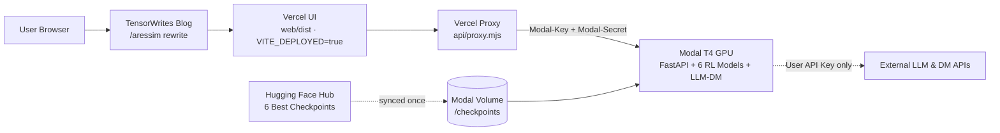

<p align="center">
  
</p>

<h1 align="center">AresSim</h1>

<p align="center">
  <b>A deterministic Mars survival benchmark for human play, reinforcement learning, and LLM + Decision Model agents.</b>
</p>

<p align="center">
  <a href="https://www.tensorwrites.com/aressim">Live Demo</a> ·
  <a href="report/aresim.pdf">Paper (PDF)</a> ·
  <a href="https://huggingface.co/tensorfiend/aressim-checkpoints">RL Checkpoints</a> ·
  <a href="https://www.tensorwrites.com/posts/aressim-env">Blog Walkthrough</a> ·
  <a href="https://youtu.be/bGrpud_uAj8">Video Demo</a>
</p>

AresSim is a deterministic `32×32` Mars rover environment for long-horizon resource logistics under partial observability. A single rover explores procedurally generated terrain, extracts ice, scans rock formations for samples, returns to a `5×5` landing pad to unload and build, and services colony infrastructure while managing battery, rover health, power margin, weather, and livability.

Python (`engine/`) owns all gameplay rules, legal-action masks, rewards, and SHA-256 state checksums. The React + Three.js web app (`web/`) and all RL / LLM adapters (`Gymnasium`, `PettingZoo`, `RLlib`, native PyTorch) share the exact same simulator transition engine — the same seed and action sequence always produce identical checksums.

<p align="center">
  <a href="https://youtu.be/bGrpud_uAj8">
    
  </a>
</p>

---

## Web Simulator

Try the hosted app at **[tensorwrites.com/aressim](https://www.tensorwrites.com/aressim)** or run it locally.

- **Manual mode:** Play directly with keyboard controls (`WASD` / Arrow keys, `E` scan, `X` extract, `B` build, `R` service, `U` unload, `Space` wait/charge) or the closable on-screen Manual Controls D-pad and action buttons.
- **Algorithm mode:** Watch baselines (`Random`, `Scripted`), six trained RL policies, or live **LLM + Decision Model** agents step through any world seed.
- **LLM-DM live stream & learnings:** Bring your own API keys (or use `.env.local` in local dev) to run Decision Model / LLM Actors paired with a live LLM Learner. A Twitch-style live feed streams goals, action probabilities, applied advice, and newly synthesized learnings in real time.
- **Replay & Analytics:** Export and reload portable `aresim.trajectory.episode.v1` JSON trajectories with checkpoint scrubbing and interactive Run Analytics charts (rewards, resources, behavior, progress, environment).
- **3D Mars Viewport:** Switch between angled 3D Survey, north-up Top, and first-person Rover POV with zoom/mini-map panning, local observation flashlight preview, analytical data layers (ice, ore, dust, roughness), and Martian day/night sky.

---

## Environment & Benchmark

| Property | Specification |
| --- | --- |
| **World** | Seeded `32×32` grid (regolith, rock, ice, crater, dune, ridge, `5×5` build pad) with dynamic weather & dust |
| **Action space** | `Discrete(10)` — Wait, Move N/E/S/W, Scan, Extract, Build, Service, Unload (with authoritative legal-action mask) |
| **Observation** | Rover-centered local crop (`aresim.obs.local.v1` and memory-augmented `aresim.obs.local_memory.v2`) |
| **Logistics** | `12 kg` shared cargo bay (`2.0 kg` per ice extraction, `0.5 kg` per rock scan); explicit pad Unload converts cargo |
| **Survival & Failure** | Battery `0%`, Rover Health `0%`, or Colony Livability `0%` ends the episode |
| **Determinism** | Exact seed reproduction with SHA-256 state checksums after every reset and step |
| **Interfaces** | Native Python (`make_env`), Gymnasium (`make_gym_env`), PettingZoo Parallel (`make_parallel_env`), and FastAPI REST |

---

## Agents & Algorithms

| Family | Controllers | Notes |
| --- | --- | --- |
| **Baselines** | `Random` (`random_valid`), `Scripted` | Same `Agent` protocol as learned checkpoints |
| **Model-Free RL (RLlib)** | `Masked PPO`, `Double Dueling DQN`, `Recurrent DQN` | Legal action masking; LSTM memory for `Recurrent DQN` |
| **Model-Based RL (PyTorch)** | `MuZero`, `DreamerV3`, `Plan2Explore` | Latent MCTS planning and RSSM world models |
| **LLM + Decision Models** | **Actors (DM):** Jev, OpenRouter Decisions, OpenAI<br>**Actors & Learners (LLM):** Anthropic, OpenAI, Gemini, DeepSeek, OpenRouter | Focused working memory + between-episode LLM Learner that synthesizes structured conditional rules |

Pre-trained reference checkpoints for all 6 RL algorithms are hosted on Hugging Face at **[tensorfiend/aressim-checkpoints](https://huggingface.co/tensorfiend/aressim-checkpoints)**. See the [illustrated algorithm guide](engine/aresim/algorithms/README.md) and [LLM-DM details](engine/aresim/algorithms/llm_dm/DETAILS.md) for architecture and prompt contracts.

---

## Quick Start

Requires **Python 3.12+** and **Node.js 20+**.

### 1. Play Locally (UI + API)

```bash
# Terminal 1 — Python FastAPI backend (127.0.0.1:8000)
python3 -m venv engine/.venv
source engine/.venv/bin/activate
pip install -e './engine[dev,env,llm_dm]'   # add rllib,muzero,world_models to load RL checkpoints
python -m aresim.api

# Terminal 2 — React + Vite frontend (127.0.0.1:5173)
cd web
npm ci
npm run dev
```

Vite proxies `/api` to `127.0.0.1:8000`. In local dev mode, LLM-DM automatically detects API keys placed in `.env.local` (copy `.env.example` to `.env.local`).

### 2. Train RL Algorithms

```bash
engine/.venv/bin/pip install -e './engine[dev,rllib,muzero,world_models]'

# Smoke / dev / reference configs exist for every algorithm under configs/
engine/.venv/bin/aresim-rl train configs/masked_ppo/smoke.yaml
engine/.venv/bin/aresim-rl train configs/masked_dqn/smoke.yaml
engine/.venv/bin/aresim-rl train configs/recurrent_dqn/smoke.yaml
engine/.venv/bin/aresim-rl train configs/muzero/smoke.yaml
engine/.venv/bin/aresim-rl train configs/dreamerv3/smoke.yaml
engine/.venv/bin/aresim-rl train configs/plan2explore/pretrain/smoke.yaml
```

Use `--set path=value` to override any typed YAML field without editing configs. See [docs/rl/usage.md](docs/rl/usage.md) for W&B logging, evaluation panels, and cloud GPU workflows ([Vast.ai](docs/rl/vastai.md), [JarvisLabs](docs/rl/jarvislabs.md)).

### 3. Run LLM + Decision Model Rollouts

```bash
engine/.venv/bin/pip install -e './engine[llm_dm]'

# Decision Model Actor (Jev) + LLM Learner
engine/.venv/bin/aresim-rl rollout configs/llm_dm/10-games.yaml --env-file .env.local

# LLM Actor + LLM Learner
engine/.venv/bin/aresim-rl rollout configs/llm_dm/llm-actor.yaml --env-file .env.local
```

Each run writes `summary.log`, `manifest.json`, `games.jsonl`, `learning.jsonl`, `selected-bundle.json`, and UI-importable `replays/` under `results/llm_dm/<experiment_name>/`.

---

## Deployment Architecture

The hosted app at **[tensorwrites.com/aressim](https://www.tensorwrites.com/aressim)** runs the React UI + authenticated API proxy on **Vercel**, the multi-user FastAPI + RL/LLM-DM inference server on **Modal (T4 GPU)**, and the 6 best RL checkpoints cached from **Hugging Face Hub** onto a persistent Modal Volume.



Editable Draw.io diagram: [docs/assets/deployment_architecture.drawio](docs/assets/deployment_architecture.drawio).

- **Modal backend ([modal_app.py](modal_app.py)):** Runs with `ARESSIM_DEPLOYED=1`, `requires_proxy_auth=True` (blocking unauthenticated hits with HTTP `401`), `max_containers=1` with concurrent multi-user sessions, and auto-scales to zero when idle.
  ```bash
  python3 scripts/upload_checkpoints_hf.py     # Upload 6 best checkpoints to HF Hub
  modal run modal_app.py::sync_checkpoints     # Sync HF checkpoints into Modal Volume
  modal deploy modal_app.py                    # Deploy locked T4 ASGI endpoint
  ```
- **Vercel frontend & proxy ([vercel.json](vercel.json), [api/proxy.mjs](api/proxy.mjs)):** Set `VITE_DEPLOYED=true`, `ARESSIM_MODAL_URL`, `ARESSIM_MODAL_KEY`, and `ARESSIM_MODAL_SECRET` in Vercel environment variables.

---

## Repository Layout

| Path | Responsibility |
| --- | --- |
| [`engine/`](engine/) | Deterministic core, FastAPI REST API, Gym/PettingZoo adapters, RL & LLM-DM algorithms |
| [`web/`](web/) | React 19 + Three.js (R3F) + Tailwind v4 UI (presentation only, no gameplay rules) |
| [`api/`](api/) | Vercel serverless proxy (`api/proxy.mjs`) injecting Modal Proxy Auth headers |
| [`configs/`](configs/) | Typed YAML experiment & evaluation configs (`masked_ppo`, `masked_dqn`, `recurrent_dqn`, `muzero`, `dreamerv3`, `plan2explore`, `llm_dm`) |
| [`scripts/`](scripts/) | Cloud training helpers, evaluation scripts, and Hugging Face checkpoint uploader |
| [`modal_app.py`](modal_app.py) | Modal T4 GPU deployment and Hugging Face → Modal Volume checkpoint sync |
| [`vercel.json`](vercel.json) | Vercel build & `/aressim` rewrite rules |
| [`report/aresim.pdf`](report/aresim.pdf) | AresSim benchmark research paper (PDF) |
| [`docs/`](docs/) | Product specifications, RL usage guides, and LLM-DM documentation |

---

## Paper & Documentation

- **Research Paper:** [AresSim: A Benchmark for Long-Horizon Resource Logistics under Partial Observability (PDF)](report/aresim.pdf)
- **Full Documentation Index:** [`docs/README.md`](docs/README.md)
  - Product & rules: [Environment Rules](docs/product/environment_rules.md) · [UI Design](docs/product/ui_design.md) · [Engine Code Reference](docs/product/engine_code_reference.md) · [Trajectory Format](docs/product/gameplay_save_format.md)
  - RL & LLM-DM: [RL Usage Guide](docs/rl/usage.md) · [RL Quickstart](docs/rl/rl_quickstart.md) · [Algorithm Diagrams](engine/aresim/algorithms/README.md) · [LLM-DM Details](engine/aresim/algorithms/llm_dm/DETAILS.md)

## Contributing & License

See [CONTRIBUTING.md](CONTRIBUTING.md) and [SECURITY.md](SECURITY.md). Licensed under **MIT** — see [LICENSE](LICENSE).
