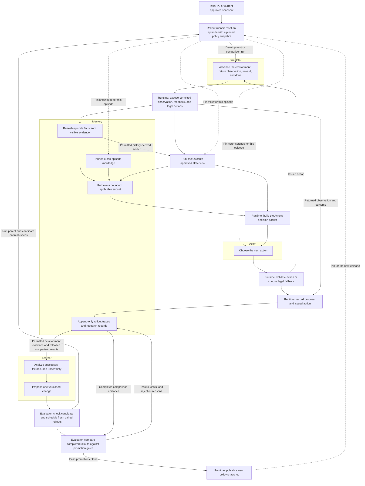

# Experience-Driven Agent Learning Plan

Status: proposed research and implementation plan. The three-pillar agent system described here is not implemented yet.

This is the single plan for the objective, workflow, component research, experiments, and implementation. Paper analyses and sources remain in the separate [literature survey](literature_survey.md). The [Jev workflow](../../engine/aresim/algorithms/jev/DETAILS.md) describes the existing decision-model agent. Consolidated: 2026-10-08. Three-pillar architecture revised: 2026-10-10.

**Implementation reference:** [Section 11: Atari Pong](#11-concrete-implementation-reference-atari-pong) specifies the executable contracts, algorithms, storage, provider adapters, UI, tests, and build order. It is a concrete example of the method, not a replacement for the AresSim objective. Its v1 scope is intentionally narrower than the research options above it. Reviewed: 2026-10-10; not implemented or experimentally validated.

## 1. Objective

Build an experience-driven agent learning system that improves through repeated interaction with simulation games, without training the LLM during gameplay. Start in AresSim, then test whether the learning method transfers to other games. Compare OpenAI, Anthropic, Gemini, and OpenRouter models on both performance and the policies they discover. Measure success, safety, latency, and total cost on unseen scenarios; keep simulator rules and hidden state outside the agent's control.

The system has three pillars: **Learner, Memory, and Actor**. These names describe responsibilities, not model types.

The **Simulator** closes their interaction loop. It supplies new observations and rewards after each action, and it runs the fresh episodes needed to test proposed improvements. It is an explicit system component with its own interface and budget. The three pillars are the parts of the *agent* that we vary; the Simulator supplies the task and feedback.

| Pillar | Responsibility | Input → output | When it runs |
|---|---|---|---|
| Learner | Interpret experience and propose improvements | Permitted development evidence and current policy → candidate lessons, state views, or memory/actor settings | Between development episodes |
| Memory | Preserve evidence, track the current episode, and supply relevant knowledge | Visible observations and executed transitions → source-linked facts and bounded retrieval results | Every step; versioned maintenance between episodes |
| Actor | Choose the next action | Current decision packet → proposed legal action or bounded information request | Every step |

**Learner** replaces the component previously called “LLM.” In the first implementation it uses a frozen LLM from OpenAI, Anthropic, Gemini, or OpenRouter. An LLM can also implement the Actor or an optional memory summarizer; that does not merge their responsibilities. Jev, Laya, and scripted controllers are other Actor implementations.

Memory is a first-class component, not simply text added to a prompt. The Learner proposes what to retain or change; Memory stores and retrieves it under explicit rules; the Actor uses it. A proposal is **not** accepted because it sounds convincing. The research question is: *Can a Learner turn experience into Memory and decision guidance that improve an Actor on new episodes, at a worthwhile cost?*

For the first study, no model weights change. The system learns by changing small, versioned pieces of information and configuration. Training a decision model can be a separate future study.

## 2. The full workflow

### Component boundaries

The **Simulator** is the environment being played. It receives actions, advances its state, and returns observations, rewards, and termination signals. The **trusted runtime** is the ordinary AresSim integration code: the observation adapter, view executor, packet builder, action validator, transition recorder, rollout runner, and experiment evaluator. It executes the three pillars' contracts and enforces permissions and budgets. The simulator defines the environment's transitions and rewards; the runtime exposes only permitted information to the pillars. The evaluator decides promotion from predeclared simulator rollouts; the Learner cannot grade its own proposal.

State preprocessing crosses two responsibilities: the Learner proposes a safe view specification, and the runtime executes that approved specification. Memory independently tracks permitted history so a compact view does not permanently discard evidence. The packet builder combines the current view with Memory's retrieval result for the Actor. The diagram has two connected loops: **playing a rollout** (Simulator → Memory/view → Actor → Simulator) and **improving the next policy** (completed rollouts → Learner → candidate → fresh simulator comparisons → new snapshot).



A **policy snapshot** `P_k` fixes the view specification, Memory's update/retrieval rules and approved knowledge IDs, packet format, Actor settings, prompts, and relevant provider/model details. It does not copy the whole raw archive into the Actor. Pin one snapshot for an episode; episode facts may evolve under its fixed rules, but lessons and configuration cannot change halfway through. This makes it possible to tell which version produced each result.

### Step and episode algorithm

Let `o_t` be the permitted observation, `g` the goal, `A_t` the legal actions, `W_t` episode working memory, and `K_k` approved cross-episode knowledge. These are not the simulator's hidden state.

```text
At episode start:
    runner chooses a permitted development/comparison seed and pins P_k, K_k
    simulator resets on that seed; reset episode memory and Actor transient state
    runtime receives the initial permitted observation
    assign the episode a read scope and simulator/API budget

At step t:
    Memory refreshes W_t from o_t and already-executed transitions
    runtime computes v_t = View(P_k, o_t, W_t)
    Memory retrieves m_t = Retrieve(P_k, v_t, W_t, K_k, g, budget)
    runtime builds packet c_t = (g, v_t, m_t, A_t, version and source IDs)
    Actor proposes a_t from c_t
    runtime validates a_t and issues it or the legal fallback to the simulator
    simulator advances and returns o_(t+1), reward/events, and done/truncated
    runtime appends o_t, packet, legal choices, proposal, issued action,
        o_(t+1), reward/events, and completion status
    continue from o_(t+1), or close the episode

After a scheduled development batch:
    Learner reads completed permitted rollout evidence and proposes one change
    Memory stores the candidate separately from approved knowledge
    evaluator checks contracts; if valid, runner resets independent simulator
        episodes on fresh paired seeds under P_k and the candidate P'_k
    evaluator scores completed parent/candidate rollouts and all costs
    runtime records every result and rejection reason in research memory
    if gates pass, publish P_(k+1) for future episodes; otherwise retain P_k
```

`rollout(policy, seed, budget)` means a complete interaction with the real task simulator: reset, repeatedly request Actor actions, advance the environment, and stop on termination, truncation, or a declared budget limit. The runner pins one snapshot for that rollout and gives it fresh episode Memory. A saved trajectory can check whether a candidate *computes* a valid action, but its stored rewards cannot score a different action sequence. Candidate value requires new simulator rollouts. The Learner receives completed development traces and released comparison results; it never sees unrevealed final outcomes or the simulator's hidden state.

Log the initial observation at reset, and use source IDs/cursors so each transition updates episode facts once. A “no memory” Actor baseline disables history/lesson input, not exact evidence logging. Replay from raw records is an optional Memory backend with the same read scope; the first backend can use just episode facts and approved lessons. Actor-requested detail or retrieval, if enabled, stays bounded and uses the same policy snapshot. Any LLM call for these operations is charged to the step budget. A provider outage must not stop exact logging or basic deterministic memory updates.

During final frozen evaluation, only within-episode memory changes. Do not expose previous test episodes to later test episodes or to the Learner. In a separately declared continual-adaptation experiment, updates may use earlier permitted outcomes, but never future results. Keep candidate-evaluation records in research memory; do not make their outcome labels available to the Actor within that comparison.

The current AresSim agent interface gives an agent the observation and action mask when it acts. This plan also needs a small **post-step feedback hook**: after an action, the LLM workflow must receive the next actor-visible observation, permitted reward/events, and whether the episode ended. Without that, it cannot reliably connect a decision to its outcome. The acting agent never receives hidden simulator state.

## 3. Learner: design state views and propose improvements

The Learner's output is a **change proposal**, not a gameplay action. It includes the parent snapshot, target component, supporting and conflicting record IDs, a small declarative edit, expected benefit, and a testable failure condition. It may propose view operators, memory selection/maintenance rules, scoped lessons, or supported Actor guidance. It cannot alter the observation boundary, evaluator, rewards, logging, or budget. Section 6 specifies how proposals are tested.

The first implementation uses one provider-neutral Learner interface. Record its model, prompts, inputs, and output so provider comparisons can distinguish proposal quality from Actor quality. A later learning scheduler belongs to this between-episode workflow, not to the Actor's action loop.

### Learner proposes a ViewSpec; runtime executes it

The Actor does **not** call the Learner to preprocess each observation. Between episodes, the Learner returns a JSON `ViewSpec`: a small program expressed using approved operators. The compiler validates it once, and the runtime executes the compiled operator graph locally before each Actor call. The Actor receives its output, not a Python script to interpret. Section 11.4 specifies the exact operators and an example. Changing the allowed operators themselves requires an ordinary reviewed code change; the Learner cannot invent an operator and run it unchecked.

Preprocessing is more than making JSON shorter. It decides which facts the actor can use. If it removes a battery warning or treats an unseen cell as empty, even a good decision model will fail.

We will separate three things:

1. **Game adapter:** trusted code exposes only the observation, goal, and legal actions available to an ordinary agent. In AresSim this starts from `aresim.obs.local.v1`, not the full `WorldState` or UI snapshot. The repository also contains `aresim.obs.local_memory.v2`, with deterministic tracking of previously observed cells; include it as a memory baseline, not as extra information silently given to one method. Each new game needs an adapter; visual games also need a way to turn images into usable observations.
2. **State view:** the Learner proposes which visible fields and derived facts to show the Actor. For example, it might show battery level, cargo, current goal, nearby resources, and recent battery change instead of every cell in an 8×8 crop. The runtime executes this view in a repeatable way. History-derived fields must name their Memory sources; the view cannot create an unlogged private history store.
3. **Optional detail requests:** if a compact view is not enough, the actor may ask a bounded read-only question about the *same* visible state. We will test whether this is worth the extra time and cost.

The Learner may choose from safe operations such as selecting fields, calculating a change over time, ranking visible cells, or summarizing a local area. The first view executor uses deterministic approved operators; any LLM-based summary is an explicit experimental backend with its own fidelity and cost tests. No backend may run arbitrary code during gameplay, read hidden fields, or invent observations. Each proposed view is saved with a version, its source fields, and a size limit. Unknown information must stay marked as unknown.

We will compare four starting choices with the **same actor and memory**: a full readable observation, a compact view written by us, an LLM-selected subset of fields, and an LLM-designed view using the allowed operations. A view is useful only if it helps decisions on new episodes after its creation and inference costs are counted. Fewer tokens alone are not enough.

## 4. Memory: evidence, episode state, and reusable knowledge

Every development episode produces a raw record: what the agent could see, what it was told, its legal choices, the action it proposed, the action actually taken, the next visible observation, and the result. These records are never rewritten.

Between episodes, the Learner may turn several records into a short lesson or subgoal. For example: “When colony power margin is positive, waiting may recharge the rover; check this before choosing Wait.” Memory stores the proposal with supporting episodes and counterexamples. Test it on independent development episodes before promotion; narrow or retire it when later evidence contradicts it.

The actor receives a bounded **decision packet**, not the whole archive. It contains the current goal, selected state view, relevant recent changes, a few applicable lessons, and legal actions. It is the actor's context. The retrieval interface must preserve conditions, unknownness, source links, and the episode/policy version.

Memory has four logically separate stores. They can share a storage engine, but have different lifetimes and access rules:

1. **Raw history:** the exact observations, legal actions, choices and outcomes the actor was allowed to see. Keep it append-only for audit and for later analysis. This is evidence, not a lesson.
2. **Episode working memory:** facts used while the current game continues, such as where the pad was last seen or which nearby cells were already explored. It is reset at the next episode.
3. **Cross-episode knowledge:** a candidate lesson, exception or short tactic inferred from several episodes. It must name supporting and conflicting records, the conditions under which it applies, and how it was checked. Only tested items enter the actor's saved policy version.
4. **Research history:** which component changes were proposed, tested, rejected or promoted, with their cost. This helps schedule *research*, not the rover's next move.

### Memory contracts and flexibility

Design memory as a **write → maintain → retrieve → use → check** loop, not as one database or one summarization prompt. Separate a stable evidence envelope from replaceable content: recent transitions, typed facts, text summaries, case indexes, and later linked notes may all implement the same interface. A graph database, vector search, or LLM on every write is not required.

| Operation | Contract |
|---|---|
| `append_transition` | Runtime writes the exact permitted record once, including proposed and executed action; no Learner filtering |
| `refresh_episode` | Update facts using current observations and completed transitions; preserve source/time and reset at episode boundaries |
| `retrieve` | Accept goal, visible view, snapshot, permitted scope, token/time budget; return relevant source-linked items or nothing |
| `stage_change` | Store a Learner proposal against an exact parent version, without changing active knowledge |
| `publish_snapshot` | Trusted runtime applies an evaluator-approved change atomically; retain old versions for audit and rollback |

Each derived item needs an ID/version, type, content, source record IDs, game/rules version, episode or transferable scope, observable applicability conditions, supporting/conflicting evidence, and lifecycle status. Confidence is an estimate, not validation. Facts also need an observation time and a validity rule: “seen resource at this cell” is not “resource still present now.” Optional tags or learned links may vary by backend; provenance and access boundaries may not.

Lessons move from **candidate → checked → active**, or to **rejected/quarantined/retired** with a reason. “Checked” means the factual or predictive claim passed specified checks; “active” additionally means its integration passed policy-value tests. Descriptive summaries without a checkable lesson remain labeled summaries and are evaluated as a separate memory baseline. A contradiction triggers rechecking or a scoped exception, not silent rewriting. Changes affect the next snapshot, not an already pinned episode. Retiring derived advice never deletes raw evidence.

At retrieval time, filter by permission, game/rules scope, lifecycle, and validity before ranking for relevance. Lesson conditions return **applicable, not applicable, or unknown**; unknown conditions cannot justify an unconditional instruction. Current observations take precedence over older conflicting state facts, while unresolved disagreements stay explicit. Fit the result to the Actor's supported packet format and budget, not merely the retriever's preferred format.

The Actor reads current-episode facts and the pinned knowledge subset. The Learner can also read permitted development traces, candidate items, and research records. Neither receives hidden state or unrevealed test results. Coordinates and resource locations belong to their episode/map, not to a global cross-seed vault. Cross-game transfer requires an explicit compatible mapping or revalidation; shared vocabulary alone is not enough.

Keep the deterministic fact tracker as the first backend. Let the Learner propose bounded selection rules, summaries, and item-level changes through allowed operations. An LLM-backed writer, retriever, or curator is an optional implementation of Memory, with separate recorded calls and costs—not permission to mutate the vault freely. Eviction from an active packet/index must be logged and must not erase its underlying evidence.

### What to compare at each stage

| Memory decision | Candidate approaches to survey and test | What would make the extra complexity worthwhile? |
|---|---|---|
| Write within an episode | Recent `k` transitions; deterministic tracked facts; LLM-updated summary; hybrid | Better decisions when needed facts leave view, without invented or stale facts |
| Select events to consolidate | Every episode; failures only; surprise; goal-relevant changes; diverse ordinary controls | More useful lessons per LLM call, not just more dramatic stories |
| Turn episodes into lessons | Raw-case retrieval; short reflection; structured conditional rule with counterexamples | A measured improvement on independent seeds at the same packet size |
| Maintain lessons | Keep all; merge duplicates; narrow on contradiction; expire/recheck under changed game version | Less negative transfer without forgetting useful knowledge |
| Retrieve at action time | Recent-first; feature/goal match; action-relevance ranking; actor-requested query | Better decisions per token and lower latency than simpler retrieval |
| Present to the actor | Raw snippets; concise evidence-linked lesson; subgoal with abort condition | The *fast actor* can use it reliably without parsing a large narrative |

Do not let the Learner decide which **raw** events exist; record them all. It may decide which episodes to summarize and which candidate lessons to propose. The evaluator—not the Learner alone—decides what is reliable and useful enough to put in the policy packet.

### AresSim cases that can reveal whether memory matters

- **Pad leaves view:** a rover that has seen the build pad later needs to return with cargo. Test whether a remembered location improves unloading and survival. [Jev already stores a remembered pad](../../engine/aresim/algorithms/jev/agent.py), so compare against that strong baseline, not just against an amnesiac actor.
- **Repeated movement:** a local view may look attractive even though the rover has just traversed the same cells. Test whether short action/location history reduces loops. Again, Jev already tracks recent actions.
- **Explored or exhausted cells:** test whether retaining what was scanned or extracted helps exploration after those cells leave the crop. A deterministic visited-cell ledger may be more reliable than an LLM summary.
- **Changing operating conditions:** a previous wait or resource action may have succeeded under different power/weather conditions. Test whether a lesson correctly checks its conditions instead of applying blindly.
- **No memory needed:** current battery, cargo and nearby resources are already observable. If history does not change the best decision, retrieval should stay empty. Otherwise memory adds cost and distraction.

The current repository also has [LocalMemoryObservation](../../engine/aresim/components/observations.py), registered as `aresim.obs.local_memory.v2`. It tracks visited cells and bearings to previously observed home/resource locations. Treat this as an existing deterministic-memory comparator after checking its observation contract, not as functionality that still needs to be invented. For matched memory tests, give each method the same initial visible observations and permitted history; identify memory supplied by the adapter separately from memory written by the LLM. Existing Jev consumes `local.v1`, so a different observation schema requires an explicit adapter, not an unannounced baseline change.

These are test *scenarios*, not claims that a particular memory system helps. In a deterministic simulation with accessible coordinates, a small structured map may solve some problems better and cheaper than language memory. If it does, use the map. Cross-episode lessons are especially easy to overstate when the game rules are fixed or the state view already gives the actor a feature such as `wait_recharges`; the research must show an added decision benefit beyond those hints.

### How to evaluate memory without fooling ourselves

Use three linked tests. Each answers a different question:

1. **Can it recall correctly?** Build answerable questions from *actual recorded trajectories*: where was the pad last seen, what action caused a cargo change, when did an earlier belief become stale? Include unanswerable questions and require abstention. This checks factual memory, not gameplay quality. [EMemBench](https://arxiv.org/abs/2601.16690) and [LongMemEval-V2](https://arxiv.org/abs/2605.12493) motivate these types of grounded probes, but their published tasks are not this simulator.
2. **Does recall change a useful decision?** Find real decision points where a fact is absent from the current local crop but present in allowed history. Replay the same visible decision context with controlled memory methods, keeping the state view and actor fixed. Record whether the action changes, whether the retrieved fact was true and whether it was relevant. This is a diagnostic screen; a recorded path cannot tell us the return of an action that was never taken.
3. **Does it improve complete new episodes?** Run the surviving methods on paired, unused development seeds. Compare objective progress, unloads, loops, failures, lower-tail outcomes, latency and total cost. Freeze a final memory version before sealed test seeds. Repeat under changed tasks and later games to detect negative transfer.

Start with `no memory`, `recent k`, `deterministic map + recent k`, `LLM summary`, `raw-case retrieval`, and `checked lessons`, using equal actor, state view and context limits. Only then test smarter selection or on-demand queries. Measure false recalls, stale facts, relevant-item recall, packet size and decision value. A memory method can be excellent at question answering yet useless for action selection; require both kinds of evidence before claiming it improves the agent.

Add stress tests with contradictory lessons, outdated observations and misleading text inside retrieved records. The actor should recognize uncertainty or ignore an unsupported item; retrieved text must not gain authority to change tools, rules or safety checks. Repeat finalist comparisons with more than one LLM learner/provider to see whether the memory method is robust or merely tuned to one model's writing style.

### Focused memory experiments

Run these separately, with the actor, visible-input contract, packet budget, and other memory stages held fixed:

| Experiment | Comparison | Failure it could fix |
|---|---|---|
| Content | Outcome-labeled cases without explanations vs reflections vs scoped lessons from successes and failures | Wrong explanations overconstrain the actor; failure lessons are omitted |
| Maintenance | Whole-summary rewrite vs item-level, versioned updates | A new summary erases an older useful condition or exception |
| Applicability | Similarity-only retrieval vs explicit condition checks with an unknown/not-applicable result | A correct lesson is used in the wrong operating context |
| Retrieval value | Recent/semantic retrieval vs a cost-aware relevance and measured-benefit heuristic | Frequently retrieved items never change a useful decision |
| Procedure, later | One-step lessons vs short parameterized subgoals with stop/abort conditions | Repeated multi-step routines are reconstructed every time |
| Episode compression, later | Recent history vs goal-conditioned chunks with source-linked summaries and bounded detail retrieval | An episode summary drops a fact needed after a goal change |
| Scope and reset | Correct episode isolation plus development-only stale/mis-scoped-item stress tests | A remembered coordinate or stale resource is mistakenly reused on a new map |

The [focused evidence cards](literature_survey.md#8-focused-evidence-cards) connect these tests to ReasoningBank, Dynamic Cheatsheet, ACE, Agent Workflow Memory, the rationale-free learning study, and two computational neuroscience models. None demonstrates that a frozen Jev/Laya actor will use these forms successfully. If the fast actor cannot express or follow a procedural packet, defer that experiment rather than silently replacing it with an LLM actor.

For item-level diagnostics, compare the same decision context with the retrieved item present, absent, and replaced by an irrelevant but similarly sized item. Do not treat action changes as reward gains. For finalists, run complete paired episodes with the retrieval mechanism enabled or disabled. Actor-reported helpful/harmful counts are hints; measured episode effects and observed contradictions are evidence. Track task ordering in streaming-learning tests, repeat multiple orders, and evaluate a frozen snapshot separately from continual adaptation.

Selected action-outcome predictions may be checked during an audit. A prediction is not required on every step, and prediction accuracy is not a substitute for better gameplay.

### Research assessment: what still needs exploration?

The existing survey is sufficient to choose initial baselines, **not** to choose a winning memory architecture. [ReasoningBank](https://arxiv.org/abs/2509.25140) motivates outcome-based strategy extraction; [ACE](https://arxiv.org/abs/2510.04618) motivates localized maintenance; [A-MEM](https://arxiv.org/abs/2502.12110) offers flexible note linking; and [MemoryAgentBench](https://arxiv.org/abs/2507.05257) separates memory competencies. None establishes value for our frozen fast Actor.

Two targeted additions address gaps rather than expand the paper list indiscriminately:

- [HiAgent](https://aclanthology.org/2025.acl-long.1575/) studies within-episode, subgoal-based compression and detail retrieval. Test this only after a strong fact tracker, with a compatible Actor and all summarization calls counted.
- [MemoryArena](https://arxiv.org/abs/2602.16313) evaluates memory-dependent actions across interdependent sessions. Borrow its decision-usefulness evaluation principle, not an assumption that independently reset AresSim episodes share state.

The next exploration should focus on **temporal/spatial fact validity, condition checking, goal-change compression, and Actor-compatible retrieval**, using the tests above. Broad chat-memory comparisons, biological labels, and graph infrastructure can wait. Detailed evidence and limitations are in the [memory design assessment](literature_survey.md#10-memory-pillar-design-assessment).

## 5. Actor: choose actions from the decision packet

The Actor receives the goal, state view, retrieved Memory items, legal actions, and policy/source IDs. It returns one proposed action tied to the current episode and step. The runtime rejects stale or malformed responses and logs the legal fallback actually executed. Optional explanations are diagnostics, not factual Memory and not proof of a good decision.

The Actor does not consolidate lessons, publish policy changes, or rewrite shared Memory. Its transient state, such as the current subgoal, is reset and logged; any retained environmental fact must be exposed through the episode-memory contract. Existing Jev's internal history remains part of the declared baseline rather than being silently removed. Optional detail/retrieval requests use runtime-managed read-only interfaces with fixed per-step limits. If an LLM handles escalation, it temporarily implements the Actor role; it does not gain Learner write authority.

The first actor comparisons are:

| Actor | Why test it? |
|---|---|
| Scripted controller | Fast, transparent baseline and fallback |
| Existing Jev agent | Current AresSim decision-model baseline |
| Jev using the new decision packet | Tests whether LLM-learned guidance improves the same kind of decision model |
| Laya using the same packet | Tests a local, typed decision model; this integration does not yet exist in AresSim |
| Direct LLM | Shows what we gain or lose by letting an LLM choose every action |

The existing `jev/` implementation stays unchanged. New Jev/Laya packet adapters belong under `engine/aresim/algorithms/llm/`. Give them the same legal choices and packet where possible. If a fast actor faces a situation outside its tested scope, the runtime may ask an LLM for one bounded decision; otherwise it uses a safe legal fallback. This escalation is part of the policy and must be counted in its cost and latency.

“Fast” means end-to-end time, not only model inference time. Hosted Jev may have network delay; local Laya has hardware and setup costs. We will measure both. We will also report how many episodes it would take for cheaper acting to repay the up-front cost of LLM learning.

## 6. Learner improvement loop and independent evaluation

The first learning loop should be simple and easy to audit:

1. Run development episodes with a fixed policy version and record all outcomes and costs.
2. Find a repeated, costly failure. Form a hypothesis about missing information, bad history, or a poor decision. Keep the cause marked unresolved when the visible evidence cannot distinguish them.
3. Ask the Learner to propose **one small change** to the state view, Memory, or Actor guidance. It must name the evidence and the improvement it expects; Memory stages it against the parent snapshot.
4. Reject changes that use hidden data, break the observation contract, exceed budgets, or omit required goal/legal-action information.
5. Screen the surviving change on recorded decisions, then use the rollout runner to play **new, paired simulator episodes** under the parent and candidate snapshots. A recorded trajectory cannot tell us what would have happened if the new policy had chosen different actions.
6. Publish a new snapshot only if it meets predeclared quality, safety, latency, and cost requirements. Memory retains rejected ideas and failures too; rejection does not change active knowledge.

Change one part at a time at first. If the state view, Memory, and Actor all change together, we cannot tell what helped. After the individual parts are understood, test useful combinations. A simple, fixed experiment scheduler should choose tests and enforce the budget; the Learner proposes ideas but does not grade itself.

The first experiment should isolate **state preprocessing**: use one goal-bearing AresSim task, one fixed actor, no cross-episode lessons, and the four state-view choices from Section 3. Next, hold the best view fixed and test memory. Only then compare actors and providers. A strong scripted policy is a valid outcome; complexity must earn its place.

### Optional controller experiments

These experiments begin only after the basic view/memory learning loop produces measurable improvements. The controller is the scheduling part of the **Learner workflow**, not a fourth pillar. It selects development work between episodes, not gameplay actions or final test seeds, and reads Memory's research records. The runtime still enforces limits; no controller may alter rewards, observation permissions, the evaluator, or budgets.

#### C1. Does checking evidence improve repair selection?

Compare these three controllers as our adaptation of [PROWL-2](https://odyssey.systems/introducing-prowl-2):

| Controller | How it chooses improvement work |
|---|---|
| Uniform | Select a recorded development failure uniformly |
| Failure-prioritized | Prefer repeated failures with large task costs |
| Evidence-gated repair | Use the same priorities, but check claims before routing work to information repair or decision improvement |

We do not add its trained world model or developer policy. The real simulator remains the source of outcomes. All arms use the same proposal generator and ordinary safety checks; evidence checks and routing are the additional mechanisms under test.

Start independent learning runs from identical policy/memory snapshots and the same initial evidence. Fix the proposer, allowed edits, safety checks, development-task distribution, and budget caps. Controllers may choose different development cases; evaluate their learned snapshots on the same independent selection tasks. Give each controller access only to completed development results, never unrevealed outcomes or final tests. Register proposal, recheck, and stopping limits before each run.

Use a bounded decision procedure:

1. Check that packet facts have permitted sources, are temporally valid, and were actually supplied to the actor. Unknown or unobserved facts are not automatically errors.
2. For a lesson with a testable claim, check its conditions and compare its prediction with the outcome of the **recorded action**. Stochastic outcomes require repeated evidence; a single mismatch need not invalidate a probabilistic claim.
3. Route a supported information problem to repair. Otherwise keep a decision-improvement hypothesis provisional. If multiple causes fit, request a one-component intervention or mark the case unresolved.
4. Screen proposed repairs offline; evaluate their policy value in fresh paired episodes. Quarantine only the affected derived item in subsequent snapshots. Preserve every raw record and the original lesson version.

For example, repeated ineffective Wait actions might come from a missing power-margin field, an overgeneralized recharge lesson, or the actor ignoring a correctly supplied condition. Restore one field or remove one lesson with other components fixed to distinguish these hypotheses. A passing information check does not prove the packet is sufficient. Do not change a pinned episode policy halfway through a run.

Measure learning curves against cumulative dollars and simulator steps, final held-out performance, lower-tail failures, harmful lesson applications, unnecessary edits, and diagnostic cost. Small injected-error probes can measure whether the controller detects a missing visible field or stale fact, but these artificial cases do not establish natural-game value. Count fallback and unresolved cases too. Match total simulator interactions and LLM spending, including diagnosis, failed proposals, repairs, and evaluation; continue sampling ordinary situations to detect regressions.

If evidence-gated routing wins, ablate it with **the same evidence checks and one shared queue**. This separates the value of checks from the value of queue separation. Stop adding routing complexity if it does not outperform the simpler controller within the predeclared budget.

#### C2. Does measured repair progress help choose the next case?

Compare the C1 winner with a simple progress-aware scheduler before introducing Dream-RSI. [ALP-GMM](https://proceedings.mlr.press/v100/portelas20a.html) motivates using learning progress instead of difficulty alone; we will not assume its continuous task-space model fits our edits.

Begin with interpretable development-case groups. Estimate repair progress from repeated, matched comparisons of policy snapshots within each group, and keep regression severity separate from positive improvement. Use multiple runs to distinguish progress from seed/model noise. Prefer work with observed improvement potential per cost, but retain a predeclared uniform-sampling share to detect forgotten or neglected situations. If the estimates are too noisy or costly, retain fixed scheduling. Never update sampling from sealed test performance.

#### C3. Does a learned research scheduler transfer online?

Dream-RSI is a later comparison against the strongest simple scheduler, not the default. Store a research tree with parent snapshot, proposed edit, evidence available at proposal time, actual evaluation, costs, and rejected branches. A replay scheduler can see only outcomes revealed by its traversal. It cannot assign outcomes to a new proposal or an unrecorded action.

Use separate historical trees for developing and selecting the scheduler, then compare in **new online learning runs** with the same total budget. Include the cost of constructing trees and optimizing the scheduler. If replay gains do not survive online, keep the experiment records but reject the meta-scheduler. This is the point at which we can test improvement of the learning procedure itself, rather than merely better gameplay.

## 7. Test whether it generalizes

Different claims need different tests:

| Test | What changes? | What it tells us |
|---|---|---|
| New AresSim seeds | Map, weather, resources, starting position | Whether the agent learned more than one episode |
| Changed AresSim tasks | Goal, reward priorities, or game settings | Whether its guidance adapts within one game |
| Related games | Some mechanics or concepts overlap | Whether knowledge and the learning method transfer |
| Different games | Observation type, actions, and rules change | Whether the *method* transfers, not whether a rover tactic does |

For a new game, compare three conditions: use the AresSim-learned system immediately; let it learn for a fixed number of target-game episodes; and start the same learner from scratch with that same budget. Call the first result **zero-shot** and the second **adaptation**. Do not treat them as the same claim. Each game needs a thin adapter for its public observation, goal, legal actions, and feedback. Record how much human work that adapter took; it must not hide a hand-written game strategy.

Possible later testbeds include [ALFWorld](https://arxiv.org/abs/2010.03768), [ScienceWorld](https://arxiv.org/abs/2203.07540), [Crafter](https://arxiv.org/abs/2109.06780), and [Procgen](https://arxiv.org/abs/1912.01588). These are candidates, not promised integrations. Choose them after checking their interfaces and evaluation cost. AresSim alone can establish new-seed performance, but not a claim of generality across games.

Keep separate development, lesson-check, policy-selection, and final test sets. The final test is used only after choosing a policy. Compare methods on matched tasks and seeds, and report success or progress, safety failures, worst-case outcomes, action loops, total cost, and decision latency. For provider comparisons, give OpenAI, Anthropic, Gemini, and OpenRouter the same starting evidence, keep their learned policy versions separate, and compare both outcomes **and** decisions in the same recorded situations. This lets us see whether the models learned similar or different policies.

## 8. Research agenda and sequence

Before choosing a mechanism, identify a decision it could change, confirm that its evidence is visible, compare it with a strong simple baseline, fit it within the actor budget, and verify new-episode benefit. A plausible architecture is not enough.

### Components to study

The rows are ordered by dependency, not by how fashionable the method is. `Now` means research should start before choosing an implementation; `Later` means a simpler baseline must exist first.

| Component | Question to answer | Simple baseline | Realistic way it might help | Main risk | Priority |
|---|---|---|---|---|---|
| Observation and feedback contract | What can the actor actually see before and after an action? | Current AresSim observation, legal mask, exact transition log | Prevents learning from unavailable information | Hidden-state or timing leak invalidates all later results | Now: prerequisite |
| State preprocessing | Which visible facts should the actor receive, and in what form? | Full readable observation and a hand-built compact view | Reduces noise while preserving battery, goal, terrain and resource signals | Drops a fact needed for a safe choice | Now |
| Within-episode history | What must be remembered after it leaves the local view? | Last `k` actions plus a small deterministic map | Return to a previously seen pad; avoid repeated moves | Incorrect locations or stale facts are worse than no memory | Now: first deep study |
| Cross-episode lessons | Which patterns from earlier games should carry over? | No lessons; then a fixed list of recent episodes | Avoid a repeated failure under similar conditions | Spurious lesson or negative transfer | Now: after history baseline |
| Retrieval and decision packet | Which history or lesson is worth showing *right now*? | Recent items in a fixed-size packet | Gives a fast actor one relevant fact instead of a long archive | Retrieval cost, irrelevant advice, context overload | Now: alongside lessons |
| Fast actor and escalation | Can Jev/Laya use the packet well, and when is an LLM call worthwhile? | Existing Jev and scripted actor | Most decisions stay cheap; hard cases get more reasoning | Fast model ignores guidance or escalation costs too much | Next |
| Improvement controller | Which failure should be investigated, and which component should be changed? | Fixed, budgeted experiment order; then uniform failure selection | Separates unreliable information from poor decisions and spends calls on repairable failures | Confident misdiagnosis; additional checks consume the improvement budget | Later |
| Cross-game transfer | Which parts survive a change of game? | Start the same learner from scratch in each game | Reuses view operators, lesson-checking and experiment method | A human-built adapter hides the actual transfer work | Later, after AresSim evidence |

Provider adapters, storage, UI controls and action validation also need careful engineering and contract tests. They do not need a new research algorithm unless their behavior changes agent decisions or the measured cost.

### Isolate the three pillars

| Pillar under test | Hold fixed | Comparison and decision |
|---|---|---|
| Learner | Initial evidence/snapshot, Memory backend, Actor, allowed edits, and total budget | No improvement loop vs scripted proposals vs LLM proposals; then compare providers. Does the resulting frozen snapshot improve independent episodes? |
| Memory | Actor and view; match source episodes and either freeze lesson content or declare content extraction as the variable | Recent history, deterministic facts, summaries, cases, and checked lessons. Does accurate, applicable retrieval improve decisions and full episodes? |
| Actor | Visible-information contract, Memory method/snapshot, view, and budgets | Scripted, existing Jev, packet-based Jev/Laya, and direct LLM. Can each use the supported packet, and at what quality/latency/cost? |

Use a manually checked packet drawn only from allowed history as a **diagnostic control** for memory-dependent decisions. If the Actor still fails, better retrieval alone may not help. This is neither hidden-state access nor an optimal-action oracle. Keep Actor-specific packet serialization explicit; changing the Actor's information or reasoning budget is not a memory-only ablation.

These tests distinguish three outcomes: the Learner proposes a bad lesson, Memory omits or misapplies a useful item, or the Actor ignores a correctly supplied item. Do not attribute the complete system's gain to all three components without these comparisons.

### Research order

| Step | Controlled work | Decision before moving on |
|---|---|---|
| R0. Contracts and evidence | Choose a goal-bearing task, feedback contract, seed splits, budgets, and initial baseline; collect traces | Is there a consequential decision requiring history? |
| R1. State views | Compare full, handcrafted compact, LLM-selected, and safe derived views with actor/memory fixed | Does the view improve fresh episodes, not just token count? |
| R2. Episode history | Compare recent history, deterministic tracking, LLM summaries, and hybrids | Does LLM-managed history beat simpler tracking after accuracy and cost are counted? |
| R3. Cross-episode knowledge | Compare cases, reflections, and scoped lessons; then isolate maintenance and retrieval | Do lessons improve new episodes without forgetting or negative transfer? |
| R4. View–memory interaction | Check whether memory restores facts omitted by compact views or better views eliminate unnecessary retrieval | Which pair works, and which component causes the gain? |
| R5. Actors and escalation | Compare scripted, existing Jev, packet-based Jev/Laya, and direct LLM actors; test bounded escalation | Is the hybrid better per total cost without safety loss? |
| R6. Controller | Run C1 repair routing, then C2 progress scheduling; C3 waits for independent research trees | Does a smarter controller improve policy quality per real cost? |
| R7. Transfer | Freeze the method; compare zero-shot, fixed-budget adaptation, and scratch on changed tasks/games | Is the transferable object a lesson, a view, or only the learning procedure? |

Use a pilot to estimate variation, then predeclare a meaningful improvement and enough paired seeds and independent learning runs to detect it. A component that cannot beat its simpler baseline should be removed or kept only as an experimental option. Research artifacts include evidence cards in the literature survey, experiment specifications, policy/memory snapshots, decision traces, aggregate results, and a keep/revise/reject conclusion. Preserve null results and rejected candidates.

### How to assess a paper

For each paper or system, record a short evidence card rather than copying its architecture. The card should answer:

1. What exact problem was studied? Was it a game, a web task, chat memory, static question answering, or a trained RL policy?
2. What changed, and what remained fixed? Was the model trained, were there expert trajectories, or was an oracle/hidden state available?
3. What baseline did the authors beat, on what split and with what metric? Were latency, tokens and calls included?
4. Which failure modes and negative results were reported? What remains untested?
5. What *specific* AresSim decision could this method improve? What simpler method could do the same?
6. What would falsify its usefulness here, and what is the smallest fair test?

Group sources by **direct evidence** (interactive agent under similar constraints), **adjacent evidence** (memory retrieval or control in a different setting), and **analogy** (brain or general optimization theory). Prefer original papers and official documentation; verify reported numbers and compare them only within their own benchmark. Include negative and null findings. A new method should enter the implementation queue only after its evidence card and test specification are written.

## 9. Build boundaries and implementation order

All substantive LLM-agent work belongs in `engine/aresim/algorithms/llm/`: provider adapters, state views, memory, decision packets, actor adapters, traces, and the experiment loop. Only small registration, feedback, CLI, dependency, and UI connections should be outside that folder. In particular, do not change the existing Jev agent just to make the new workflow work.

Organize that folder by responsibility rather than duplicating a complete pipeline for each model:

| Planned area | Contents |
|---|---|
| `learner/` | Evidence analysis, typed proposals, lesson extraction, optional experiment scheduling |
| `memory/` | Exact history, episode facts, item versions, indexes, retrieval, and lifecycle operations |
| `actors/` | Scripted, direct-LLM, Jev, and Laya packet adapters and bounded escalation |
| Common modules | Contracts, provider clients, safe views, packet builder, workflow, evaluation, traces, and tests |

Provider/model-specific prompts or experiments can have small configuration folders, but must use the shared contracts, Memory, evaluator, and logging. These are planned boundaries, not directories implemented by this document change.

OpenAI, Anthropic, Gemini, and OpenRouter should use one common LLM interface. Select provider/model independently for the Learner, direct-LLM Actor, and any optional Memory LLM backend; do not require all roles to use the same model. Keep API keys on the server and attribute usage to the role and operation. A fake provider is needed for tests that make no paid calls. Gameplay components may inspect only permitted visible information. They cannot access shell, Git, arbitrary files or network services, hidden state, reward code, or unrevealed test results. The runtime checks legal actions, timeouts, budgets, stale responses, and fallbacks.

The UI should expose the same three pillars: **Learner** provider and proposal history; **Memory** backend/configuration, episode facts, retrieved IDs/sources, and candidate versus active lessons; **Actor** implementation, decisions, and fallback/escalation. Select a saved policy snapshot for a run and disable unavailable options. Show the state view, short-term goal, action, latency, and cost split by role. A memory inspector should explain why an item was included, omitted, stale, or inapplicable. The experiment view shows accepted and rejected changes; viewing logs must not grant the agent additional information. The UI displays results; it does not contain the learning algorithm or API keys.

Store each run as an immutable experiment record: policy version, view and memory versions, code/environment versions, seeds, actions and outcomes, provider usage, costs, and promotion decision. This is the evidence needed to reproduce a result and to compare models fairly.

Most improvements should change a saved state view, lesson, or decision packet—not source code. If a later experiment needs a new mechanism, test that code change in a separate branch or worktree. Automated edits may touch only `engine/aresim/algorithms/llm/`; run tests and review the exact diff before using it in an experiment. A gameplay agent never edits its own code.

| Phase | Deliverable |
|---|---|
| 0. Contracts | Learner/Memory/Actor interfaces, feedback hook, action validation, exact traces, snapshot isolation, and fake-provider tests |
| 1. Baselines | Deterministic episode Memory, full/compact views, direct LLM support for all four providers, scripted/Jev comparisons, and basic UI controls |
| 2. Learner state views | Safe view proposals and matched-seed tests against full and handcrafted views |
| 3. Memory | Case/summary/lesson comparisons, source and scope checks, staged item updates, retrieval, and memory inspector |
| 4. Integrated learning | Independently checked promotions, Jev/Laya packet adapters, and cost-aware escalation; isolated pillar comparisons |
| 5. Transfer | New-game adapters and zero-shot/adaptation/from-scratch comparisons |
| 6. Optional research | Test PROWL-inspired repair routing, learning-progress scheduling, active branching, prompt search, Dream-RSI, or a swarm only against measured simpler baselines |

## 10. Limits and open decisions

Dream-RSI might later help decide **which experiment to run next**. It does not tell a rover which action is best, and replaying past traces cannot reveal the results of actions never taken. Brain-inspired memory is a useful way to think about raw experiences and learned lessons, but it is not proof that this design will work. A swarm or an automatically edited codebase is also not part of the first agent.

Improving views, lessons, and actor guidance is **experience-driven policy improvement**. Improving the controller that chooses future learning work is a separate, later claim. Use “RSI” cautiously: better gameplay alone does not show that the system has improved its own learning procedure.

The reviewed works do not establish that a frozen Jev/Laya can follow learned guidance, that language memory beats deterministic tracking, or that reliable failure attribution is affordable. These remain experiments, not established capabilities.

The important failure cases are clear: the LLM's view removes needed information; lessons are wrong or do not apply in new situations; a fast actor cannot use the packet; performance gains disappear on new seeds; or the learning cost is greater than the benefit. If that happens, keep the useful part and narrow the claim. The goal is a reliable learning method, not a collection of impressive-sounding components.

Before live AresSim experiments, we still need to choose the first goal-bearing rover task, a spending and latency limit, and the final test split. Section 11 uses Pong to resolve implementation ambiguity now; it does not make those AresSim choices or establish cross-game results.

## 11. Concrete implementation reference: Atari Pong

### 11.1 Scope and the claim we will test

Build a pixel-observation Pong runner to make the contracts above executable. Pong is a small, established Atari benchmark with an immediate reason to use history: a single image gives a ball position, but not its direction. It is a **reference harness**, not an instruction to replace AresSim or modify the existing RL agents. [Official Pong specification](https://ale.farama.org/environments/pong/).

The first question is narrow: **Can a frozen LLM improve a fixed local rule interpreter by proposing state features and source-linked conditional decision rules, without changing weights or writing executable Python?** The improved object is an external policy snapshot. We are not claiming that Pong proves general intelligence, that long-term narrative memory is necessary, or that the learning algorithm recursively improves itself.

V1 includes deterministic visual detection and tracking, declarative views, typed rule memory, a local Actor, a between-episode Learner, an independent evaluator, exact logging, four hosted-provider adapters, and an inspection UI. No online summaries, vector database, unrestricted code generation, model training, swarm, world model, Dream-RSI controller, or Actor tool calls. These are not dependencies of a working first system.

The following numbers are **our proposed engineering defaults**, not results from papers. Before the measured study, lock them in an experiment manifest; change them only in a new study version. Actual model IDs, price ceilings, and the tested ALE dependency version must be supplied before a paid/live run. This document authorizes neither installation nor spending.

Navigation: [environment](#112-environment-actions-timing-and-permissions), [perception/history](#113-visible-objects-and-episode-memory), [preprocessing](#114-exact-preprocessing-contract-viewspec-v1), [rules/Actor](#115-cross-episode-memory-and-the-fast-actor), [storage](#116-storage-immutability-and-access-control), [Learner](#117-learner-input-proposal-algorithm-and-allowed-experiments), [evaluation](#118-independent-evaluation-and-promotion), [providers](#119-provider-implementation-and-failures), [runtime](#1110-runtime-algorithm-and-one-complete-example), [files/UI](#1111-files-ui-and-integration-boundaries), [tests](#1112-build-sequence-and-acceptance-tests).

### 11.2 Environment, actions, timing, and permissions

Use this constructor in `adapters/atari_pong.py`:

```python
gym.register_envs(ale_py)
env = gym.make(
    "ALE/Pong-v5", obs_type="rgb", render_mode="rgb_array",
    frameskip=1, repeat_action_probability=0.25,
    full_action_space=False, mode=0, difficulty=0,
    max_num_frames_per_episode=108_000,
    max_episode_steps=108_000,
)
```

The adapter repeats one Actor command for **four individual `env.step()` calls**, stopping early on termination/truncation. It retains each returned frame and reward. Thus a normal decision covers four emulator frames, not sixteen. Set both ALE's frame limit and Gymnasium's step limit explicitly; with frameskip1 they count the same advancement. Do not add `AtariPreprocessing` with its own action repeat or max-pool the frames used for detection. Preserve the original frames. This is an object-based reference protocol, not the usual grayscale neural-network input pipeline. [ALE environment parameters](https://ale.farama.org/environments/), [ALE Gymnasium implementation](https://raw.githubusercontent.com/Farama-Foundation/Arcade-Learning-Environment/master/src/ale/python/env.py), [Gymnasium preprocessing wrapper](https://gymnasium.farama.org/api/wrappers/misc_wrappers/).

Contract:

- Input observation: RGB `uint8[210,160,3]`. Coordinates use the original image, with x increasing rightward and y downward. No RAM, emulator object coordinates, opponent policy, save-state bytes, or debug information enter any pillar.
- Reward: sum the unchanged per-frame rewards. Record point events separately; no shaping, reward clipping, life-loss termination, or hidden reset/FIRE sequence. A full game ends normally when a side reaches 21; a horizon exit is `truncated`, not a win. [Pong reward/termination implementation](https://raw.githubusercontent.com/Farama-Foundation/Arcade-Learning-Environment/master/src/ale/games/supported/Pong.cpp).
- Actions: obtain `env.unwrapped.get_action_meanings()` and resolve indices by name. Support all six minimal actions through the adapter. V1 RuleActor uses only semantic `hold`, `up`, and `down`, mapped to NOOP and the two non-FIRE movement commands. Hosted-Actor comparisons use this same three-action subset; a six-action study is a separate configuration.
- Do not assume ALE's RIGHT/LEFT labels directly mean screen up/down. Calibrate once for the installed ROM/adapter version: on development seeds 0–3 with sticky actions disabled, run at most 120 NOOP frames until the visible paddle is at least 20 pixels from either image edge; save the **visible command prefix**. Reset and replay that prefix independently for each movement command, then hold the command for eight frames. Require a known paddle before/after every probe and the same nonzero sign of y displacement in all four probes; the two movement commands must have opposite signs. Commit the up/down mapping and calibration traces to the adapter manifest; fail startup if inconclusive. This calibration is public engineering input, counted separately from learning, shared by every arm, and never redone on final seeds. Benchmark runs still use sticky probability 0.25.
- Sticky actions mean the emulator can retain a previous action. Log the Actor's proposal and the command issued on each frame; label the internally applied joystick action **unknown**. Do not call the issued command the observed executed joystick action.
- Reset episode facts and Actor state on `env.reset(seed=...)`; pin the snapshot first. Close the environment in `finally`. Never silently restart an errored episode and count it as a successful completion.

Construct actor-visible metadata explicitly; never forward ALE's complete `info` dictionary, which can contain seeds on reset. Use our own frame/tick counters and the permitted reward/termination flags. Private seed/debug metadata stays evaluator-only. The adapter tests inject a seed field into `info` and assert it never appears in packets, evidence windows, or model calls.

Two explicit timing modes avoid an impossible promise:

| Mode | Mechanism | What the result means |
|---|---|---|
| `offline` | Pause simulator advancement while Actor computes; impose a 10-second hosted-Actor timeout | Measures decision quality and actual throughput. Remote APIs can participate, but this is not real-time play. |
| `paced` | Local Actor only in v1; target four frames per measured emulator frame-rate interval, approximately 66.7 ms at 60 Hz | Measures whether the whole local path meets a real-time deadline. No hosted Actor is advertised as real-time. |

For paced mode, execute detection/view/retrieval/Actor in a single worker process; allocate a 20 ms decision deadline within the interval and measure environment stepping and logging separately. On timeout or worker failure, issue NOOP, discard the result identified by its old `tick_id`, and restart the worker for the next tick. Never apply a late action to a new state. If the total loop exceeds the interval, record an overrun; do not drop frames and pretend the deadline was met. Acceptance requires measured p99 total time below the interval on the named machine. The Learner is absent from this path.

### 11.3 Visible objects and episode Memory

Implement `detect(frame, frame_id) -> DetectionFrame` using NumPy color masks and 8-connected components. A component's bounding box is `[x_min,y_min,x_max_exclusive,y_max_exclusive]`; its center is the midpoint of the covered pixel-center coordinates. Initial detector settings are:

| Object | RGB equality mask | Allowed image rows | Component bounds, inclusive |
|---|---|---|---|
| Player paddle | `[92,186,92]` | `30 <= y < 194` | Width 2–8, height 4–32 |
| Opponent paddle | `[213,130,74]` | `30 <= y < 194` | Width 2–8, height 4–32 |
| Ball | `[236,236,236]` | `34 <= y < 194` | Width 1–8, height 1–8 |

The palette/crop starting points come from [OCAtari's pixel-based Pong detector](https://raw.githubusercontent.com/k4ntz/OC_Atari/master/ocatari/vision/pong.py). Component bounds are our unvalidated defaults. Excluding the HUD prevents score digits becoming paddles. Require exactly one qualifying component per object; otherwise return `null` with `absent` or `ambiguous`. Do not reuse a previous bounding box as a current detection. Do not use OCAtari's RAM backend. Version the detector and validate it against the actual installed ROM before experiments.

`EpisodeMemory` is a deterministic ledger, updated on **every emulator frame**, including frames between Actor decisions:

| Field | Update/validity rule |
|---|---|
| `detections` | Last eight DetectionFrames; older raw observations remain in the archive |
| `ball_vx`, `ball_vy` | Latest consecutive detected-center difference divided by elapsed emulator frames; units pixels/frame |
| `velocity_sources` | IDs of the two frames used; valid only while the latest detection is current and both frames belong to the same rally |
| `rally_id` | Increment after any nonzero reward; clear ball history/velocity before processing the next frame |
| `recent_commands` | Last 16 decision commands, durations, and proposal/fallback status |
| `point_events` | Last 100 point events with reward and trace IDs; current score counts accumulated from visible reward |
| `detector_status` | Per-object absent/ambiguous flags and consecutive missing count |

If detection is missing, clear velocity immediately. On reacquisition, require two consecutive detections; do not bridge a missing interval or score reset. When velocity changes sign, use the freshest difference, not an average across a bounce. This is a noisy observed estimate, not an oracle; no certainty score is invented. Regression tests must cover score-reset jumps, a wall bounce, occlusion, and duplicate update IDs.

At a decision boundary, `ObservationBundle` contains current detections, the last-frame ID, legal semantic actions, frame/tick/rally IDs, and permitted reward events. Memory supplies a namespaced source catalog, for example `obs.ball.y`, `obs.player.y`, `obs.player.x`, `episode.ball.vx`, `episode.ball.vy`. Every scalar is wrapped as `Datum(value, unit, source_frame_ids, valid_at_frame, status)`. Unknown is JSON `null`, never zero. Catalog entries have fixed units and visibility rules.

The first implementation is deliberately hand-engineered perception plus temporal tracking. The LLM chooses what to derive/use **after** these measurements. End-to-end learned vision is not secretly being solved by the Learner. For another game, this detector must be replaced; our later transfer measurement must count that adapter work.

Validate tracking as well as detection: keep pixel-only annotated short clips for movement, wall/paddle contact, zero displacement, and disappearance. Test exact finite differences against those visible centers. A zero displacement means zero **observed** velocity, not proof the ball has stopped; a one-step estimate can be poor at a bounce or under sprite update cadence. Log these cases and retain the eight-frame history for a later measured tracker variant. Do not improve the tracker automatically in a rule proposal or smuggle future frames into the estimate.

### 11.4 Exact preprocessing contract: ViewSpec v1

`ViewSpec` is JSON with `schema="llm.view.v1"`, `nodes`, and `outputs`. Nodes have unique IDs matching `[a-z][a-z0-9_]{0,31}`. An output maps a feature name to a node ID. Maximum 64 nodes, depth eight, and 24 scalar outputs. No loops, recursion, generated source, or string expressions.

Allowed node shapes:

| Operator | Required parameters | Semantics |
|---|---|---|
| `field` | `source` | Read an allowlisted current observation/episode field |
| `const` | `value`, `unit` | Finite numeric literal; unit one of `scalar`, `px`, `frame`, `px/frame` |
| `add`, `sub` | `args: [id,id]` | Same-unit inputs; preserve unit |
| `mul`, `safe_div` | `args: [id,id]` | Infer dimensions; reject unsupported output units. Division by magnitude below `1e-6` returns null |
| `abs` | `arg: id` | Preserve unit |
| `clip` | `arg: id`, `min`, `max` | Finite literal bounds in the argument's unit; min <= max |
| `mod` | `args: [id,id]` | Same-unit inputs and positive divisor; result in `[0,divisor)` |
| `coalesce` | `args: [id,id]` | Same-unit inputs; return second only if first is null, with fallback provenance retained |

All arithmetic except `coalesce` propagates null. Derived values carry the union of source IDs and their oldest validity bound. Supported dimensions are scalar, px, frame, and px/frame; evaluation may use temporary dimensional products only when they reduce to a supported output. Do not let constants claim observation provenance. `field` cannot read seeds, held-out outcomes, hidden RAM, raw archive paths, or provider credentials.

`compile_view(spec, catalog, actor_contract) -> CompiledView` performs strict schema validation (`additionalProperties=false`), bounds/type/unit checks, dependency resolution, cycle detection, and source permission checks. It verifies every Actor-required feature and every active rule reference exists with the expected type/unit. Compile once per snapshot into a topologically ordered instruction list; execute with ordinary Python operator functions, **not `eval` or `exec`**. Runtime errors produce a typed failure and fallback; they do not trigger ad hoc source generation. Hash canonical JSON plus executor/catalog versions.

Runtime budget: 2 ms for view execution plus rule-graph evaluation/retrieval on the named benchmark machine; measure this rather than assuming it. A budget failure excludes the result and uses hold. Operator outputs must be finite or null; overflow returns null with a reason. Reject numeric literals outside `[-1e6,1e6]`. Canonicalization sorts object keys, preserves array order, forbids NaN/Infinity, and encodes UTF-8 without whitespace before SHA256. All contract models forbid extra fields, implicit string-to-number coercion, and unversioned payloads.

Minimal valid example:

```json
{
  "schema": "llm.view.v1",
  "nodes": [
    {"id": "ball", "op": "field", "source": "obs.ball.y"},
    {"id": "paddle", "op": "field", "source": "obs.player.y"},
    {"id": "offset", "op": "sub", "args": ["ball", "paddle"]}
  ],
  "outputs": {"ball_y": "ball", "player_y": "paddle", "offset_y": "offset"}
}
```

For a more useful candidate, the Learner can assemble `tau = (player_x-ball_x)/ball_vx`, then `projected_y = ball_y + ball_vy*tau`, from the same operators. Only apply a corresponding rule when `ball_vx > 0` and `tau` is finite and nonnegative. A test input `ball=(100,80)`, `player=(140,100)`, `velocity=(2,1)` yields `tau=20 frames`, `projected_y=100 px`; following current `ball_y` would instead aim at 80. This example demonstrates the executor, **not** that straight-line extrapolation wins Pong: wall bounces, paddle contact geometry, and changes in speed can make it wrong.

We do not provide a built-in `optimal_intercept` or bounce solver as a learned feature. Generic `mod`/`abs` arithmetic permits a Learner to propose a reflection formula; that formula still needs evidence and fresh-episode tests. If we write such a formula ourselves, label it a handcrafted comparator. The baseline ViewSpec and visible catalog are identical for all Learner providers.

This answers the script question precisely: it is a **restricted declarative program compiled by trusted code**, selected between episodes and executed locally before the Actor. Arbitrary Learner-written Python is unnecessary in v1.

### 11.5 Cross-episode Memory and the fast Actor

Natural-language lessons alone cannot change a scripted Actor. V1 therefore stores a bounded, machine-readable **decision rule** alongside its plain-language explanation and evidence. No claim of general memory intelligence is needed to execute it.

`DecisionRule` fields:

| Field | Required type/constraint |
|---|---|
| `id`, `version`, `parent_snapshot` | Runtime UUID, positive integer version, and parent SHA256 string; immutable |
| `scope` | Exact game ID, mode, difficulty, detector version, catalog version |
| `when` | At most four AND-connected predicates; each is `{feature, cmp, value}` with cmp in `lt/le/gt/ge/eq/is_known`; numeric literals have the feature's unit; `value=null` only for `is_known` |
| `target_feature`, `target_expression` | Exactly one is nonnull: a named `px` ViewSpec output, or a bounded expression graph defined below |
| `deadband_px` | Finite value in `[0,16]` |
| `explanation` | At most 400 characters; explanatory, not executable |
| `support_ids`, `counterexample_ids` | At most eight permitted trace-window IDs each |
| `status`, `evaluation_id` | Candidate/contract-valid/evaluated/active/rejected/retired; result UUID or null before evaluation |

Each proposal changes either the view, one rule (including a replacement/retirement), or retrieval settings—not all three. Initially there are no learned rules. A view change must remain compatible with existing rule references. Maximum 32 active rules. V1 rules specify desired paddle targets; they do not directly issue arbitrary commands or introduce subagent calls. This search space is intentionally limited and stated in the experiment report.

`target_expression` uses the same node shapes as ViewSpec, with at most 16 nodes, depth eight, and four outputs. Require an output named `target` with unit px; other outputs may be used by this rule's predicates. Predicate references are `view.<output_name>` or `rule.<output_name>`. Evaluate the graph first, then its predicates; nulls exclude the rule. It may read the same allowlisted observation/episode catalog as ViewSpec, never another rule's private graph. Compile these graphs with the view compiler and include their source permissions in snapshot validation. Maximum 32 × 16 additional nodes per retrieval. Rules with `target_feature` do not have a `rule.*` namespace. Metadata/status is assigned by trusted code, not accepted from a model's proposed payload.

This is necessary for an implementable one-change search: a new tactic can carry its needed arithmetic in **one rule proposal**. Otherwise adding an unused global feature could fail promotion before a subsequent rule gets a chance to use it. Rule-local features are disclosed in the Actor packet, with their sources and cost; they are not a hidden history store. Global-view experiments still matter for direct LLM/Jev Actors and existing rules that consume named outputs. For RuleActor with no learned rules, adding unused global features is not expected to change behavior.

`retrieve_rules(view, source_catalog, snapshot)` first checks scope and active IDs, evaluates each allowed rule graph, then predicates using three-valued logic. Any null-dependent condition is unknown and excludes the rule. Require a known target; clip the returned target to image y coordinates `[0,209]` and record whether clipping occurred. Sort applicable rules by descending predicate count, descending number of distinct supporting **development** episodes, then ascending ID. Return the first three and log exclusion reasons. No embeddings, LLM retrieval, test-score ranking, or self-reported confidence. Retrieval-spec proposals may change top-k within 0–3 or choose `specificity_first` versus `support_first`; these are the only v1 retrieval settings. Replacing any rule in a full store must explicitly identify the retired ID; do not silently evict evidence.

`RuleActor.act(packet)` is fixed trusted code:

```text
if player_y or ball_y is unknown: return hold
if any retrieved rule exists: target = first rule's target; db = its deadband
else: target = ball_y; db = 2 pixels
delta = target - player_y
if delta < -db: return up
if delta > db: return down
return hold
```

The RuleActor requires view outputs `ball_y` and `player_y` in px; these names must remain direct reads of `obs.ball.y` and `obs.player.y`, respectively. The compiler rejects removing or relabeling these physical measurements. It does not bypass the view to read Memory privately. Its follow-ball fallback is a disclosed handcrafted baseline. Learned features/rules can improve its target selection, but cannot change its interpreter. If the actor already solves the benchmark, there is no useful learning claim; report the ceiling and choose a harder task.

Other actors implement the same `act(DecisionPacket) -> ActionProposal` interface:

- **Direct LLM:** serialize the same features, three retrieved rules with their explanations/sources, recent permitted facts selected by the view, and legal actions. Return exactly `{tick_id, action, used_rule_ids}`. No private conversational state or automatic chain of prior provider requests. The Actor need not obey advice; record which retrieved IDs it reports using and measure behavior, not just its claim.
- **Jev:** add `actors/jev.py`, reusing only the existing `JevClient.system_one` transport without changing Jev files. Construct Pong-specific state and choice criteria; translate the returned choice to semantic up/down/hold. Never reuse rover questions. Validate tick identity, allowed choices, confidence/probabilities, and timeout; server capability must be tested before enabling this adapter.
- **Laya:** reserve the interface and a disabled capability entry. The repository does not establish a usable Laya transport/model contract; do not invent one. Enable only after obtaining and testing that contract. It is not a dependency of v1.

Every packet has `{schema, episode_id, tick_id, frame_id, snapshot_hash, goal, features, retrieved_rules, legal_actions}`. Goal is fixed: maximize unshaped episode return. Feature data retains source/validity IDs. Retrieved items contain ID/version, evaluated target/deadband, evaluated local features, explanation, condition result, and source-window/frame IDs—not source code. Actor output is always `ActionProposal(tick_id, action, used_rule_ids)`, including the RuleActor's wrapped result. Allowed actions are up/down/hold; used IDs must be a subset of retrieved IDs. No confidence threshold is treated as evidence of correctness.

Episode IDs are runtime UUIDs; tick/frame IDs include that episode ID plus their local index, so a replay endpoint never ambiguously selects tick 0 from several episodes. Maximum serialized packet 16 KiB. Bound provenance lists to eight frame IDs per Datum, rule source windows to eight each, and explanations as above; validate a worst-case packet during compilation and fail closed if a runtime packet nevertheless exceeds the cap. Do not silently drop lessons. Snapshot capability metadata states required features, supported rule format, and timing mode. Provider, Actor, and Memory choices remain independent.

### 11.6 Storage, immutability, and access control

Use SQLite in WAL mode plus losslessly compressed frame chunks under an explicitly configured run directory. No graph/vector service is required. Proposed run layout:

```text
run_manifest.json
records.sqlite
snapshots/<sha256>.json
frames/<episode_id>/<chunk_id>.npz
provider_io/<request_id>.json
reports/<evaluation_id>.json
```

`RunManifest` must contain: schema version; experiment/run UUIDs; code revision and dirty-diff hash; dependency-lock hash; adapter/detector/catalog/operator versions; ROM checksum; exact environment kwargs/action mapping; timing mode/machine fingerprint; initial snapshot hash; evaluator-only seed-manifest reference/hash; evidence selector RNG seed; Actor/Learner provider, model, prompt/schema hashes and generation limits; phase; simulator/API/disk/time ceilings; price-table version; and explicit `paid_calls_enabled`. Default false and USD ceiling 0 permit fake/local tests only. Store secrets outside the manifest. Preserve a scoped source patch for measured uncommitted implementation changes, not just its hash. Refuse an unexplained dirty code revision or missing ROM/lock identity in a measured run; an exploratory run may proceed but is labeled non-reproducible.

`PolicySnapshot` contains: schema; parent hash; compiled-view specification/hash; active rule ID/versions; retrieval spec; Actor contract/config; packet schema; source catalog and operator versions; associated prompt/model/generation settings when the Actor is hosted; creation proposal and evaluation IDs. The Learner configuration belongs to the RunManifest, not the policy executed by the Actor. Store the snapshot's own hash outside its canonical hash input. P0 has a null parent and an explicit engineering-baseline provenance tag.

Load and compile a snapshot's rules once at episode start and retain them in memory. Retrieval does not query SQLite or reconstruct a graph on every tick. SQLite/chunk writes belong to the recorder; the Actor receives neither a connection nor a file handle.

`records.sqlite` has these tables; JSON payloads are validated by the shared contracts before insertion:

| Table | Key and contents |
|---|---|
| `episodes` | ID; split/learning-run/snapshot; evaluator-only seed; start/end/status; return; frame count; terminated/truncated/error |
| `frame_chunks` | Episode/chunk key; frame range; array shape/dtype; relative path; SHA256 |
| `transitions` | Episode/tick unique key; pre/post frame IDs; issued commands/rewards per frame; exact packet; proposal; fallback reason; timings; source IDs |
| `rules` | Rule ID/version key; immutable rule payload, source IDs, evaluation ID |
| `rule_events` | Append-only status changes and reasons; no rewriting old rule versions |
| `proposals` | ID; parent hash; target; exact response; schema/contract result; evidence scope |
| `evaluations` | ID; candidate/parent hashes; seed-manifest hash; episode IDs; metrics; gate results; conclusion |
| `provider_calls` | Request/attempt ID; role/operation; provider/model; sanitized input/output refs; timing/status; reported token usage; cost/unknown usage |
| `snapshots` | Hash; immutable path; versions; parent; approved IDs; publication event |

Write frame chunks in groups of at most 256 original frames: temporary file, checksum, atomic rename, then commit its index and dependent transitions. Maintain bounded pending transitions until their frames are durable. On crash, mark the episode incomplete and reconcile orphan chunks; never complete a transition pointing to a missing frame. Final partial chunks flush on close. Unique episode/tick/frame keys make writes idempotent. Publication checks parent hash, writes a content-addressed snapshot, and changes the active pointer atomically between episodes. Run startup verifies referenced hashes.

One 210×160 RGB frame is 100,800 bytes; a 108,000-frame episode can exceed 10 GB uncompressed. Do not assume negligible storage. Lossless compression helps Pong, but measure it. A 256-frame buffer is about 25.8 MB before compression. Default run disk cap is 10 GiB, configurable before launch; stop admission/collection before crossing it, mark incomplete work, and do not delete earlier evidence to continue. Persist a storage estimate from the pilot before the full study.

Expose three read facades, not a database handle: Actor reads only its packet; Learner reads scoped development windows/research results; evaluator reads seed manifests and sealed results. Pass no absolute archive paths or seed values to models. Remove secrets/authorization headers from provider records. Store submitted prompts and returned answers for reproducibility, not hidden reasoning traces. The UI is an operator's inspector; its ability to inspect evidence is not an agent permission.

### 11.7 Learner input, proposal algorithm, and allowed experiments

`Learner.propose(EvidencePacket) -> ChangeProposal` runs between development batches, never on the gameplay critical path. It is one schema-constrained call, not an autonomous shell agent.

Start from snapshot P0 (three-feature view above, no learned rules, default retrieval). For each independent learning run, execute **four fresh development episodes**, collect evidence, propose at most one change, and evaluate it. Repeat at most eight batches. Keep the current snapshot if any stage fails. The Learner can see its previous proposals and aggregate development comparison results, including rejections, but not final episodes.

Build evidence mechanically:

1. Enumerate point events from those four episodes. Sort by episode/tick. Select up to two -1 events and two +1 events using a seeded uniform sample without replacement; select two additional uniform ordinary windows from ticks at least 16 decisions away from a point. Missing categories stay missing.
2. Each selected window contains eight consecutive decision transitions ending at its anchor, with visible object/velocity fields, packet, proposed/issued command, reward, and rule IDs. Include links to the full source windows. Do not label every action before a loss as wrong or assert the last action caused it.
3. Add per-episode return/frame count, missing-detection frequency, fallback frequency, current ViewSpec/rules, prior candidate outcomes, and the operator/catalog documentation. Input cap 64 KiB UTF-8 and provider context limit, whichever is smaller. Fit whole windows deterministically in selection order; never truncate a transition mid-record. Record omitted-window IDs. V1 sends typed visible measurements, not raw images; all Learners get the same available evidence for a matched experiment.
4. Prompt asks for one minimal supported change, referenced evidence and counterexamples, expected metric, and a reason it might fail. A model may return `no_change`. No request for private chain-of-thought, fabricated counterfactual scores, or a new training algorithm.

`ChangeProposal` contains `schema`, `proposal_id`, `parent_snapshot_hash`, `kind` (`view_replace/rule_add/rule_replace/rule_retire/retrieval_replace/no_change`), nullable payloads for each kind, supporting/counterexample IDs, `expected_effect`, and `failure_condition` (each at most 400 characters). Require exactly the selected kind's payload and null other payloads; limit proposal output to 32 KiB. Generate provider-specific schema envelopes from this contract and perform the stronger kind/permission checks locally. `proposal_id` is runtime-assigned; overwrite/reject a model-supplied conflicting ID rather than trusting it.

Payload mapping: `view_replace` supplies a full ViewSpec; `rule_add` supplies rule content without trusted metadata; `rule_replace` supplies the existing ID/version and replacement content; `rule_retire` supplies the existing ID/version and reason; `retrieval_replace` supplies `{top_k, ranking}`; `no_change` supplies no payload. Evidence IDs must resolve within the submitted/development scope. Empty support is allowed but marked speculative, including the prior-only control; fabricated IDs reject the proposal. Publication evidence comes from the independent evaluation, not from retroactively inventing supporting episodes.

A rule is a candidate tactic, not a proved physical law. V1 uses `candidate → contract-valid → evaluated → active/rejected` for rules. Reserve the earlier section's factual “checked” status for claims with a declared prediction test; do not grant it merely because a policy got a higher score. Explanatory prose never becomes a fact automatically.

The experiment controller is a deterministic eight-batch loop in v1. It does not implement PROWL routing or Dream-RSI. A later controller can propose which component to investigate, but must beat this same-budget schedule; that is a separate experiment, not needed to make this loop concrete.

### 11.8 Independent evaluation and promotion

Specify seed manifests before collecting measured data. Calibration uses 0–3; generate other seeds by drawing uint32 values from a seeded NumPy `Generator(PCG64(master_seed))`, rejecting 0–3 and any previously drawn value until the required count is reached. This avoids allocating the entire uint32 population. The master seed and generated list are evaluator-only recorded artifacts. Allocate fixed blocks in manifest order: pilot, four development seeds per batch, 16 comparison seeds per batch, then 64 sealed final seeds. Blocks are disjoint; corresponding provider/control arms use the same block schedule but separate evidence stores. Different independent learning runs receive disjoint development/comparison blocks. Assert disjointness at startup. Pilot seeds are never reused for measured comparison/final evaluation. Seed values and final outcomes do not enter Learner/Actor packets. Common initial seeds reduce comparison noise; different policies need not encounter identical later states or sticky-action sequences.

Candidate gates, in order:

1. **Contracts:** compile, check source scopes/IDs, unit/type limits, rule compatibility, snapshot size, cost configuration, and actor capability. Reject attempts to change detector, action map, rewards, evaluator, or budget. No simulator calls for an invalid proposal.
2. **Recorded-observation regression:** replay at least 200 development decision inputs, including all available missing/bounce/reset cases; require zero executor exceptions/invalid commands and no missing required fields. This verifies computability, not policy value. Recorded trajectories cannot tell us the reward of an alternative action.
3. **Fresh paired simulator episodes:** for each of 16 previously unused comparison seeds, create a parent rollout and a candidate rollout with the same environment configuration. Each calls `run_episode` from a fresh simulator reset, with its own pinned snapshot and freshly reset Memory and Actor. Pair the resulting episode returns by seed. The rollouts may diverge after their first different action; do not reuse a parent trajectory as the candidate's simulated outcome. Pinned rule sets do not adapt within this batch. Count simulator errors, provider outages, disk/budget stops, and incomplete pairs explicitly; do not selectively remove a candidate's bad runs. An incomplete batch cannot promote.
4. **Value gate:** let `d_i = R_candidate_i - R_parent_i`. Require mean `d >= 1.0` Pong return point and a positive lower endpoint of a 95% paired-bootstrap interval (10,000 resamples, fixed evaluator RNG seed). Also require zero invalid issued actions, fallback rate <=1%, and no increase of more than 0.5 percentage points over parent. In paced mode require the timing gate in 11.2. Report truncated episodes and rewards without converting them to wins. If a guard fails, reject even if return improves.
5. **Publication:** store metrics, interval, hashes, every gate and cost; activate the new snapshot only for the next development batch. Rejected candidates and their complete evidence remain stored.

Define fallback rate as fallback-issued decisions divided by all decisions, not a rate over emulator frames. Ordinary RuleActor hold on an unknown ball is a planned behavior, logged separately from execution/provider failure fallback. Bootstrap resamples 16 paired deltas with replacement, computes a mean per resample, and uses the 2.5/97.5 percentiles; never resample individual frames as independent outcomes. Evaluation episode errors fail the complete-batch gate; environment-contract violations pause the study for diagnosis rather than becoming a lesson.

These are screening rules, not a statistical proof: eight repeated proposals can overfit development comparisons, and 16 pairs can be underpowered. A pilot estimates variance; if the proposed test cannot detect a one-point change, increase its predeclared size in a **new** manifest before the study, not until a candidate happens to pass. The sealed final test is the primary evidence. Failure to promote is a legitimate outcome.

Budget arithmetic matters. Eight proposals × 16 seeds × two policies × 108,000 frames permits **27,648,000 comparison frames per learning run**, plus up to 3,456,000 development frames. Default simulator cap: 32 million frames per run, excluding separately recorded calibration/pilot/final budgets. Reserve enough for a complete comparison before starting it; if insufficient, retain the parent and stop. Maximum eight Learner calls plus bounded retries. Local RuleActor uses no API calls. A direct hosted Actor could require 27,000 calls per long episode; therefore it is **not** the default actor for the full learning study.

Final protocol:

- Freeze the resulting snapshot from each of three independently collected learning runs. Run each on the same sealed 64-seed set, with no cross-episode learning or memory sharing.
- Compare with P0 and a preregistered scripted sequence of typed changes using the same candidate budget. Add a **prior-only LLM** condition: generate up to eight independent candidates from P0, with catalog/documentation but no observations, outcomes, or evolving accepted snapshot; evaluate them against P0 on its scheduled comparison blocks, then choose the highest mean-return candidate that passed the gate, tie-breaking by candidate ID. This tests prior-informed candidate search, not an adaptive Learner. Keep its selection on development comparisons and its final report on the sealed set.
- To isolate the value of detailed trajectories, also use a **no-trajectory adaptive** control with the same current snapshot and aggregate comparison feedback as our Learner, but no transition windows. Do not call this no-experience: it receives experience through feedback. The prior-only comparison changes both evidence and adaptivity; it cannot by itself attribute a gain to trajectory memory.
- Match proposal attempts and simulator budgets; retain unused budget in the report rather than spend it on a different search. Report provider comparisons for OpenAI, Anthropic, Gemini, and OpenRouter with specified underlying model and routing, not provider brand alone. Execute this matrix only if the total budget is approved.
- Isolate Memory/feature effects with no temporal fields, tracked velocity only, and tracked velocity plus learned rules. For a rule-removal ablation retain the view and interpreter; for a temporal-feature ablation remove dependent learned rules and disclose that compatibility requires this joint change. Do not call such a joint ablation memory-only.
- Report return distributions, paired differences/intervals, full-game completion/truncation, learned snapshot content, fallback/detection errors, frames, total wall time, all calls/tokens/costs, storage, and variation across learning runs. Seed intervals alone do not capture learning-run variation. No leaderboard-generalization claim from one game.

Optional short hosted-Actor probes use a separately labeled 7,200-emulator-frame horizon and hard call/spending ceilings. Do not compare their return directly with full-game results. Provider price tables must be dated and verified before spending; missing usage is unknown cost, never zero. Budget exhaustion is a stop condition, not permission to switch models unnoticed.

### 11.9 Provider implementation and failures

Use a shared async `generate_json(role, operation, input, schema, limits) -> ModelResult`. `ModelResult` records parsed value or typed failure, submitted/provider model IDs, request/attempt IDs, latency, reported usage and budget reservation. A fake implementation supplies deterministic proposals/actions and failure fixtures. Model IDs are explicit config, not hardcoded “latest.” Tools, browsing, code execution, and provider conversation chaining are disabled.

| Provider adapter | Native request contract | Normalization |
|---|---|---|
| OpenAI | Responses `/v1/responses`; `input`, `text.format={type:json_schema,name,schema,strict:true}`, `max_output_tokens`, `store:false` | Extract final message text; handle refusal/incomplete status before JSON validation. [Official guide](https://developers.openai.com/api/docs/guides/structured-outputs?api-mode=responses). |
| Anthropic | Messages `/v1/messages`; `system`, `messages`, `max_tokens`, `output_config.format={type:json_schema,schema}` | Extract text blocks; reject refused/truncated/nonfinal results. [Official guide](https://platform.claude.com/docs/en/build-with-claude/structured-outputs). |
| Gemini | Interactions `/v1beta/interactions`; `input`, `response_format={type:text,mime_type:application/json,schema}`, `generation_config.max_output_tokens`, `store:false` | Use the official SDK's `output_text`; normalize status and usage; no `previous_interaction_id`. [Structured outputs](https://ai.google.dev/gemini-api/docs/structured-output), [API reference](https://ai.google.dev/api/interactions-api). |
| OpenRouter | Chat completions `/api/v1/chat/completions`; `messages`, `response_format={type:json_schema,json_schema:{name,schema,strict:true}}`, `max_tokens`, `provider.require_parameters:true` | Validate content/finish status; record reported served model/provider and configured routing; missing routing metadata stays unknown. [Official guide](https://openrouter.ai/docs/guides/features/structured-outputs). |

Implement with official OpenAI/Anthropic/Google SDKs and an HTTP client for OpenRouter; pin tested SDK versions in the optional dependency lock. Provider request schemas use only their supported subset; local contract validation enforces all bounds even when a provider cannot. A `doctor` operation checks configuration and optional dependencies without network access; a separately user-enabled capability probe makes a small paid request for the chosen model. A model that cannot satisfy the schema is marked unavailable—no silent free-text downgrade. Native syntax above was checked on 2026-10-10 and must be rechecked when dependencies change.

Use a provider-neutral **wire schema** to avoid unsupported dynamic object keys: serialize `outputs` as an array of `{name,node}` entries, and normalize it to the canonical ViewSpec map after rejecting duplicate names. Wire nodes have fixed required keys `{id,op,source,value,unit,args,arg,min,max}` with unused parameters null; `args` is an array or null. Normalize away unused nulls, then apply the exact operator schema checks in11.4. Proposal envelopes likewise have every payload key present, but unselected payloads null. All wire objects forbid extra properties; bounds/selected-kind/units remain locally enforced. Save both wire response and normalized proposal. This translation changes representation, not model permissions or available operators.

Default token ceilings per request: 8,192 total generated tokens for a Learner proposal and 512 for a direct Actor response, including any provider-counted reasoning allocation. Reject a configured model whose supported controls cannot bound the operation sufficiently for its approved spending ceiling; do not assume all four APIs have identical reasoning settings. Prompt input must also fit the chosen model's context limit with this output reservation. Authenticate with server-side `OPENAI_API_KEY`, `ANTHROPIC_API_KEY`, `GEMINI_API_KEY`, or `OPENROUTER_API_KEY`; OpenRouter and OpenAI use separate credentials even where request shapes resemble each other.

Defaults: Learner timeout 60 seconds, at most one retry for 429/5xx/network timeout with bounded backoff inside a 120-second operation deadline; **no Actor retries**. Refusal, malformed JSON, semantic invalidity, auth failure, and unsupported schema are not retried as new creative requests. Learner failure yields no proposal; Actor failure yields NOOP and a trace reason. Disable SDK automatic retries so actual attempt counts are known. Cancellation need not cancel remote billing: reserve worst-case configured tokens before dispatch and retain uncertain-cost reservations until reconciliation. Include prompt/answer/reasoning/cache charges using the provider's reported billing categories; do not double-count tokens included in another category. Abort further paid work on unresolved price/usage bounds or exhausted budget.

### 11.10 Runtime algorithm and one complete example

The core interfaces are synchronous local functions except provider calls and worker orchestration:

```text
RolloutRunner.run_episode(snapshot, seed, phase, limits) -> EpisodeResult
Adapter.reset(seed) -> ObservationBundle
Adapter.advance(command, repeat=4) -> FrameOutcomes
Memory.ingest_frame(frame, reward, frame_id) -> None
View.execute(bundle, episode_memory) -> FeatureMap
Memory.retrieve_rules(features, current_catalog, pinned_snapshot) -> RetrievalResult
Actor.act(packet) -> ActionProposal
Recorder.append_completed_transition(transition) -> None
Learner.propose(evidence) -> ChangeProposal
Evaluator.evaluate(parent, candidate, manifest) -> EvaluationResult
Publisher.publish(parent_hash, result) -> SnapshotHash
```

`Adapter` is the Simulator boundary: its `reset` creates a fresh Pong episode, and each `advance` sends the chosen command to ALE and returns the newly generated frames, rewards, and end flags. `RolloutRunner` owns the adapter, enforces frame/cost limits, and records the exact simulator outputs. Learner and Actor have no direct `reset`, `step`, seed, or save-state access. Only the evaluator selects comparison seeds; the final seed manifest remains sealed until reporting.

`run_episode` ordering:

```text
validate manifest and compiled snapshot; reset Actor and episode Memory
reset env; record and ingest the initial frame once
while not ended and budgets permit:
    execute pinned ViewSpec from current observation and episode Memory
    retrieve pinned active rules; build bounded packet with current tick_id
    request Actor decision under the selected timing mode
    validate tick_id/action; use hold for failure, never reuse an old response
    advance up to four individual frames with the validated command
    for each frame: record raw outcome, update Memory exactly once
    append completed transition and timing/cost metadata
    increment tick; set current observation to the last returned frame
flush raw chunks; record completed/truncated/aborted status; close env
```

The between-episode caller then performs the outer loop:

```text
for batch in 1..8:
    development = [run_episode(P_active, seed, "development", limits)
                   for seed in this_batch.development_seeds]
    candidate = Learner.propose(select_allowed_evidence(development, past_results))
    if candidate is no_change or fails contract checks: record and continue
    for seed in this_batch.comparison_seeds:
        parent_result = run_episode(P_active, seed, "comparison_parent", limits)
        candidate_result = run_episode(P_candidate, seed, "comparison_candidate", limits)
        record both results as one pair
    evaluation = score_complete_pairs_and_costs()
    publish P_candidate only if every predeclared gate passes
```

The comparison pair uses separate simulator resets. Save each rollout's own observations, issued commands, rewards, termination reason, and snapshot hash. After scoring, release the aggregate comparison result to the next development batch as specified in the Learner's read scope. During a comparison, neither policy receives the other's trajectory or the pair's eventual score. Final evaluation runs the same `run_episode` interface with frozen snapshots and a read scope that prevents cross-episode learning.

An illustrative trajectory, not a fabricated experimental result:

1. At decision t, current visible ball center is `(100,80)`; the previous frame showed `(98,79)`. Memory estimates `(vx,vy)=(2,1)` from those source IDs. Player center is `(140,100)`.
2. P0 gives `ball_y=80`, `player_y=100`, `offset_y=-20`; no rule applies. RuleActor issues up. The runtime repeats that command four frames and records the actual returned frames/rewards; the outcome is **not** assumed in advance.
3. After a development batch, the Learner references several windows and proposes one conditional intercept rule carrying its expression graph. The graph exposes `vx`, `tau`, and `target`; its predicates require `rule.vx > 0` and `rule.tau >= 0`. Missing inputs propagate null and exclude it. This is one rule change; P0's global view/retrieval stay fixed.
4. In the numeric example its evaluated target is 100, so RuleActor chooses hold. The evaluator runs fresh paired games before publication. A plausible formula that fails the value gate stays rejected; neither the explanation nor this example overrides that result.
5. If the straight-line rule loses on bounces, the failure windows remain evidence. A later proposal may narrow its condition or replace its arithmetic. The runtime will neither grant it access to hidden future trajectories nor execute arbitrary code. The final frozen snapshot reveals exactly the formula/conditions learned.

The rule's exact expression graph can be constructed with these 11 nodes: six `field` nodes (`player_x`, `ball_x`, `ball_y`, `vx`, `vy`, `player_y`); `dx=sub(player_x,ball_x)`; `tau=safe_div(dx,vx)`; `travel=mul(vy,tau)`; `target=add(ball_y,travel)`; `error=sub(target,player_y)`. Export `target`, `vx`, and `tau`; omitting the unused diagnostic `error` and its `player_y` input gives a nine-node version. With deadband 2 and two predicates, this is fully representable in the declared rule schema. It contains no wall-bounce correction; that limitation should appear in its failure condition.

### 11.11 Files, UI, and integration boundaries

All substantive backend implementation is inside `engine/aresim/algorithms/llm/`. Planned modules and required entry points:

| File/area | Responsibility |
|---|---|
| `contracts.py`, `config.py` | Strict Pydantic contracts, source catalog, snapshot/manifest validation; export JSON schemas |
| `adapters/base.py`, `adapters/atari_pong.py` | Reset/advance/close, legal action mapping, calibration, observation boundary |
| `perception/pong.py` | Color-mask detection; no hidden-state methods |
| `views/compiler.py`, `views/operators.py` | Compile and execute both ViewSpec and rule expressions |
| `memory/episode.py`, `memory/rules.py`, `memory/store.py` | Frame facts, deterministic retrieval, SQLite/chunk persistence and scoped facades |
| `actors/base.py`, `actors/rule.py`, `actors/direct_llm.py`, `actors/jev.py` | Packet capability contracts and decision adapters |
| `providers/base.py`, `providers/{openai,anthropic,gemini,openrouter,fake}.py` | Request translation, validation, usage/failure normalization |
| `learner/evidence.py`, `learner/propose.py` | Deterministic window selection and one-change proposals |
| `evaluation.py`, `snapshots.py` | Fresh seed scheduling, paired comparisons, gates, atomic publication |
| `workflow.py`, `worker.py`, `cli.py` | Episode loop, paced decision worker, study orchestration, doctor/run/evaluate/export commands |
| `api.py`, `tests/`, `configs/pong_v1.json` | Scoped API router, fixtures/tests, locked reference defaults |

Only three kinds of external hook are needed: an optional dependency extra in `engine/pyproject.toml`; `create_app()` mounting the LLM router; and a new UI workspace entry. Do not edit existing DQN/PPO/Jev behavior. Add a later `adapters/aresim.py` and thin post-step hook when applying these exact contracts to the rover. That is a separately tested adapter, not pretending Pong's image/action interface matches AresSim.

The React UI needs a separate `web/src/llm/` workspace and `web/src/api/llmClient.ts`; do not insert Pong frames into the rover-specific `SimSnapshot` or its ActionBar. Backend endpoints:

| Endpoint | Request/response and restriction |
|---|---|
| `GET /api/llm/capabilities` | Available adapters/providers/actors with reasons for disabled choices; no keys |
| `POST /api/llm/runs` | Validated `{experiment_config_id, snapshot_hash, actor_config, learner_config, timing_mode, budgets}` → run ID; reject missing paid-run approval/budgets |
| `GET /api/llm/runs/{id}` | Status, pinned hashes, counters, cost and errors |
| `POST /api/llm/runs/{id}/stop` | Stop at a safe boundary, flush/mark interrupted; no evidence deletion |
| `GET /api/llm/runs/{id}/events?after=cursor&limit=100` | Cursor-paged public event records, bounded max500; never database SQL or arbitrary paths |
| `GET /api/llm/runs/{id}/ticks/{tick}` | Exact permitted frame/packet/proposal/issued commands, rule explanations and exclusion reasons |
| `GET /api/llm/runs/{id}/frames/{frame_id}` | PNG rendering of a verified archived frame reference |
| `GET /api/llm/snapshots/{hash}` | Validated immutable specification and provenance |
| `GET /api/llm/evaluations/{id}` | Comparisons/gates/cost; sealed test results withheld until release |

Worker process owns its environment; API handlers do not block on emulator/model work. V1 runs one study job at a time; return 409 for a conflicting start. Poll events at most once/second; show historical decisions aligned to recorded frames rather than replaying the whole simulation on the UI thread. On server shutdown stop/join the worker and reconcile incomplete records. Restrict IDs to manifests, reject path traversal, and keep the API local unless authentication is added separately.

UI panes: **Learner** (model, evidence windows, proposal diff, rejection/promotion); **Memory** (current facts, exact source frames, active/candidate rules, retrieval/exclusions); **Actor** (frame, features, chosen command, fallback/deadline/usage). An experiment pane shows paired returns and total cost. Mark offline runs as offline. Disable Laya, unconfigured models, and unvalidated capabilities rather than presenting them as working options. Operators select a snapshot for a new run; UI edits cannot mutate the snapshot of an active episode.

### 11.12 Build sequence and acceptance tests

Implement in this order; every gate is required before paid studies:

| Stage | Concrete deliverable | Pass condition |
|---|---|---|
| A. Contracts and fake loop | Strict schemas, fake image adapter/provider, record store, local RuleActor | Unit tests for scopes, nulls, invalid/stale actions, snapshot isolation, idempotent ingestion; an end-to-end fake proposal promotes/rejects without network |
| B. Real Pong adapter | Optional ALE dependency, action calibration, palette detector, tracking, chunk logging | Two same-seed/same-command rollouts reproduce with pinned build; four-frame repeat test; reset/reward/truncation checks; no hidden-state reads |
| C. Perception validation | At least 200 manually annotated pilot frames across startup/motion/bounces/points, plus 10 synthetic absence/ambiguity fixtures | >=99% object presence agreement and <=1 px center error for matched objects; any score-digit false positive fails; version/fix before measured runs |
| D. View/rule executor | Compiler, bounded arithmetic, private rule graphs, retrieval | Synthetic numeric example passes; cycle/unknown-source/NaN/unit/oversize tests fail closed; null predicates excluded; deterministic ranking; max-node benchmark recorded |
| E. Local play and UI | P0 full episodes, worker, router, three-pillar inspector | Complete traces replay all packets/frames; user can locate a rule's evidence; fault-injection stop/crash recovers without phantom completions; paced timing measured if enabled |
| F. Provider adapters | Four clients, fake HTTP/SDK fixtures, capability probes only with authorization | Refusal/429/timeout/schema/cost accounting tests; configured models produce valid envelopes; keys never in API/log exports |
| G. Learner/evaluator | Evidence sampling, eight-batch controller, fresh paired games, bootstrap gates | Fake positive/zero/negative candidates produce correct outcomes; split-leak tests; rejected candidate cannot mutate parent; budget reserve prevents partial comparison |
| H. Measured study | Locked manifests, pilot-based power/budget estimates, independent runs and sealed final results | Reproducible report including rejected changes and null outcomes; no claim of benefit before results exist |

Use `python -m pytest engine/aresim/algorithms/llm/tests` for new tests, plus existing engine/web regression checks. ALE integration tests skip with an explicit missing-dependency reason; they are mandatory in the configured reference environment before stage B passes. Live provider tests are opt-in and never part of default CI. Each provider normalization needs recorded or sanitized fixture cases for successful JSON, invalid choices, incomplete/refused output, missing usage, and attempted instruction injection in source evidence.

CLI acceptance commands, run from `engine/` after the modules exist:

```bash
python -m aresim.algorithms.llm.cli doctor --config aresim/algorithms/llm/configs/pong_v1.json
python -m aresim.algorithms.llm.cli run --manifest <local-manifest.json>
python -m aresim.algorithms.llm.cli evaluate --parent <hash> --candidate <hash> --manifest <evaluation-manifest.json>
python -m aresim.algorithms.llm.cli export --run-id <uuid> --format json
```

These are future commands, not currently available tools. `doctor` exits nonzero with structured reasons for missing capabilities; `run` checks reserved budgets before allocating a worker; `evaluate` cannot publish without every gate; `export` excludes credentials and unreleased sealed outcomes. The engine-root equivalent test command is `python -m pytest aresim/algorithms/llm/tests`.

Repository inspection on 2026-10-10 found Gymnasium 1.2.2 in the engine environment but no `ale_py`, and no implemented LLM package. Consequently this revision validates the design against source/documentation, **not** actual Pong perception, performance, model compatibility, or real-time latency. Stage B/C results can require detector/control-map corrections; they cannot silently alter a measured experiment.

### 11.13 What transfers, and what does not

Reusable code: contracts, bounded compiler, immutable Memory/provenance, provider clients, Actor interface, proposal/evaluation controller, storage, budget checks, and UI. Game-specific work: legal observation/action adapter, perception/source catalog, baseline actor capability, feedback and episode semantics. Learned Pong interception rules should normally fail scope checks in another game; the transfer candidate is primarily the **learning procedure**, not those coordinates/formulas.

Pong is a test of immediate temporal estimation and small external-policy improvement. It is a weak test of long-term episodic retrieval or rich strategic memory. If deterministic tracking plus a handwritten target already saturates performance, stop expanding Memory for Pong and move to a separately specified game with genuine longer dependencies. Benchmark zero-shot use, fixed-budget adaptation, and from-scratch learning separately, count manual adapter labor, and never present results from this one adapter as broad generalization. The [ALE evaluation-protocol paper](https://arxiv.org/abs/1709.06009) is a reason to make the protocol explicit, not evidence that our proposed method succeeds.

New Pong seeds under fixed mode/difficulty principally test stochastic trajectories, not new game rules or visual layouts. A pretrained LLM may already know Pong strategies. The prior-only and no-trajectory controls are essential to distinguish prior knowledge/policy search from value added by our recorded experiences. Passing this reference study is permission to design the next benchmark, not evidence that richer Memory or RSI is required.
