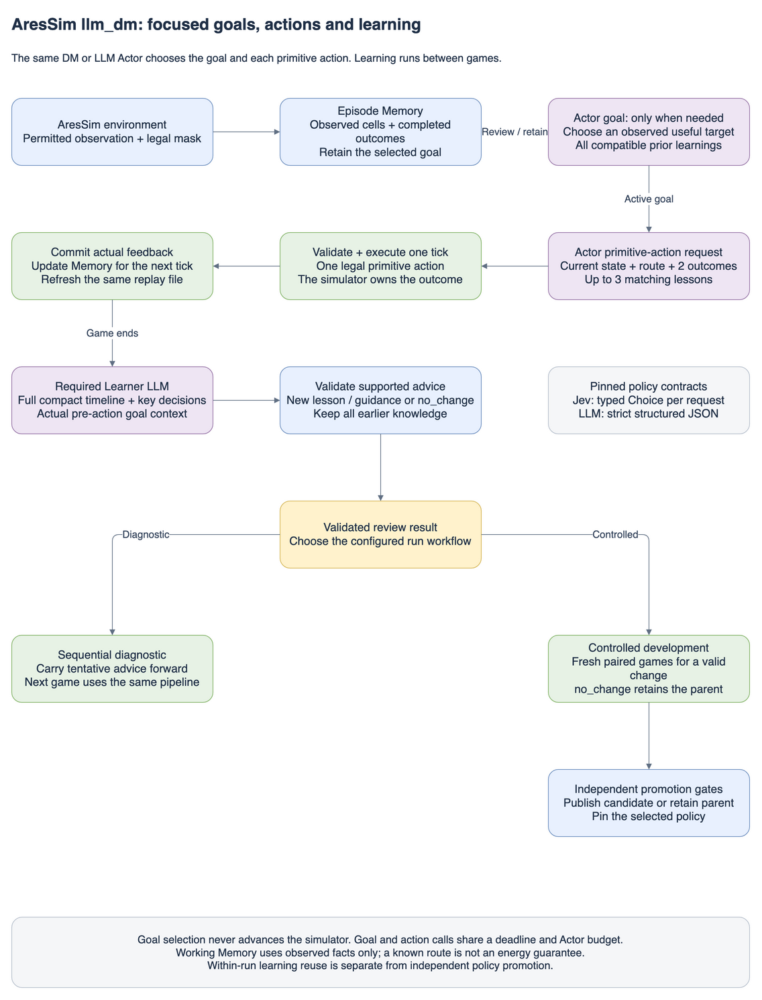
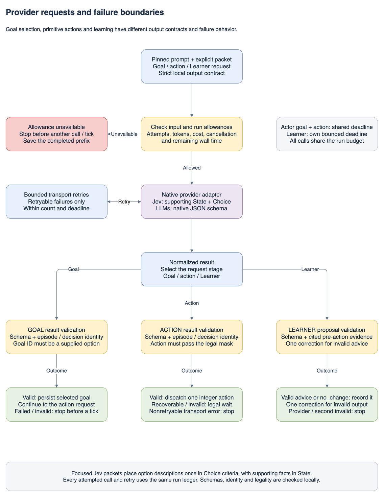
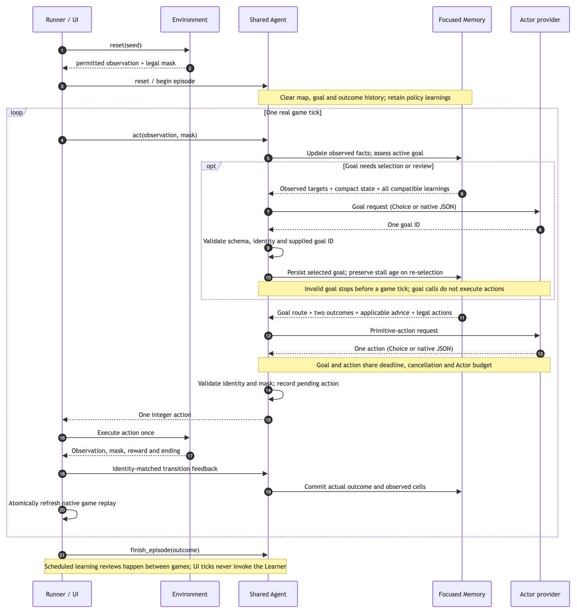
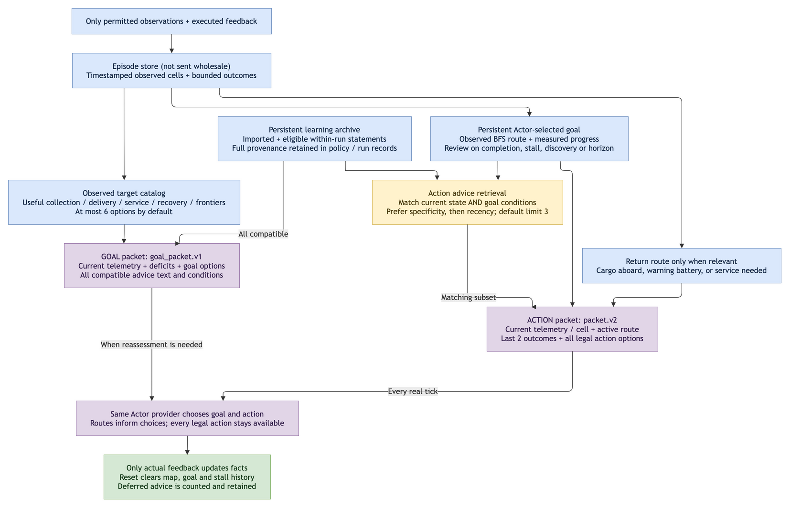
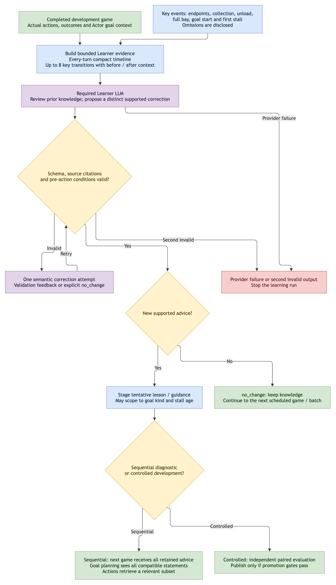
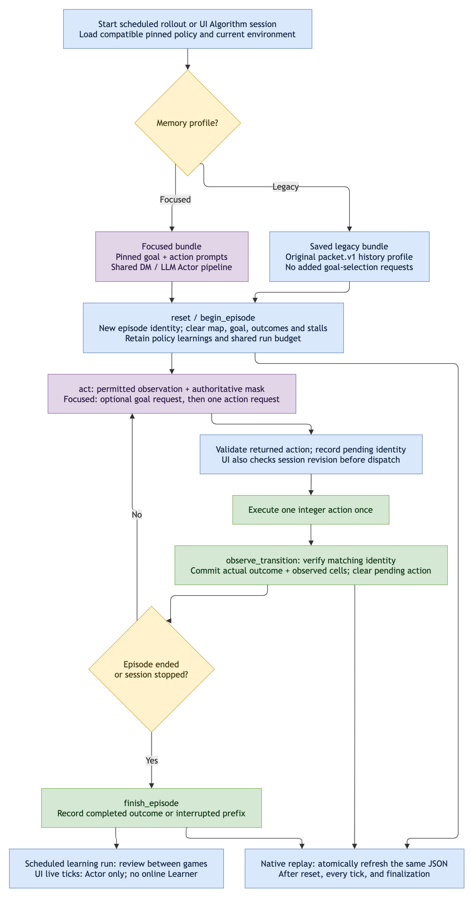
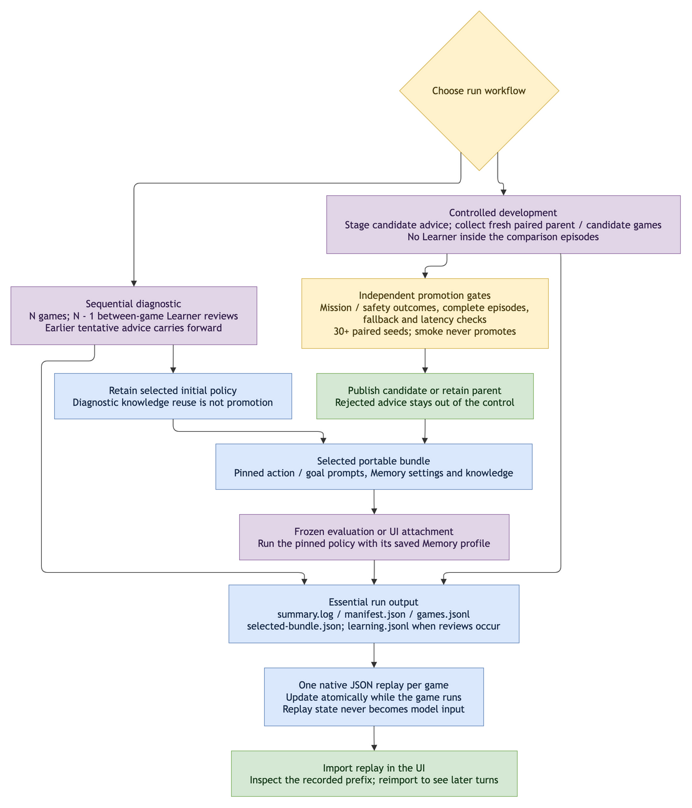

# AresSim llm_dm implementation guide

Updated: 2026-11-08. This is the sole implementation reference for the shipped hybrid pipeline. It replaces the separate `llm` and `decision_models` algorithms.

## Core idea

One Actor controls the rover for one tick at a time. It can be a TypeSafe Decision Model or an LLM. Both consume the same permitted State, action mask, episode Memory and persistent learnings. A mandatory LLM Learner reviews completed game evidence between learning batches and proposes bounded, source-linked advice for subsequent games. Model weights are never updated.

`actor.provider` selects the Actor. `learner.provider` selects an LLM independently. There is one orchestration loop, one Memory implementation, one artifact layout and one UI algorithm ID: `llm_dm`. Decision Models are not allowed as Learners.



## Repository ownership

- `engine/aresim/algorithms/llm_dm/rollout.py`: collection, required learning rounds, sequential reuse and independent evaluation.
- `agent.py`: `LLMDMAgent`, one pending decision, executed feedback and episode closure.
- `state.py`: the permitted-observation encoder and configured public game requirements.
- `memory.py`: timestamped observed cells and bounded completed-transition history.
- `common/decision_context.py`: the provider-independent input packet.
- `providers/http.py`: native HTTPS adapters, including TypeSafe Choice normalization. No TypeSafe SDK is required.
- `prompts/actor.txt`, `prompts/learner.txt`, `prompts.py`: clear role instructions and public-rule injection. Exact rendered prompts are pinned in the bundle/manifest.
- `knowledge.py`, `learner.py`, `evaluation.py`: evidence checking, candidate bundles and promotion gates.
- `common/learnings.py`: JSONL statement extraction, deduplication and source snapshots.
- `artifacts.py`, `reporting.py`: essential machine-readable records and human summaries.
- `training/runner.py`, `training/trajectories.py`: shared simulator execution and progressive UI replay export.

## Actor and provider contracts

| Role | Supported providers | Native output |
| --- | --- | --- |
| Decision Model Actor | `decision_models` / TypeSafe | One `action` Choice from legal criteria |
| LLM Actor | `openai`, `deepseek`, `anthropic`, `gemini`, `openrouter` | Strict action JSON |
| LLM Learner | The same LLM providers | Strict proposal JSON, or `no_change` |
| Offline verification | `transport: fake` | Deterministic canned Actor/Learner responses; no network |

Each role pins provider, model, credential environment-variable name, generation settings and call/input/output limits. Credentials are read locally and never appear in prompts, bundles, logs or replays. `--env-file .env.local` reads only the configured credential names; it does not execute shell content. Decision Model Actors use `output_mode: choice`; LLM roles use `native_schema`.

TypeSafe receives the shared packet as `state`, the exact rendered Actor instructions as question instructions, and one criterion for every legal primitive action. Each legal criterion includes its action effect and, for moves, destination observations, recent arrivals/reversal and the change in observed-home grid distance. These are factual descriptors shared with LLM Actors, not a route guarantee or action override. Its selected key is wrapped in the same validated internal action contract used by an LLM Actor. Resolved model, usage, confidence and probabilities are retained when reported. Confidence does not replace a legal model choice; there are no forced collection priorities, random second-choice substitutions or legacy action overrides.

The checked-in TypeSafe profile pins `jev-1.14.0`. Its published price is $0.042 per million input tokens, with output free; the dated local price sheet records the source. Default TypeSafe limits are 64k tokens per request and 32k per question. The runtime uses conservative UTF-8-byte reservations and bounded history; it does not enable long-context headers. See [TypeSafe models](https://docs.typesafe.ai/models).



## State, Action and Agent contracts

The Actor never receives `WorldState`, hidden cells, simulator checksums, replay snapshots, future transitions, withheld evaluation outcomes, API keys, or an environment seed. Inputs come only from the environment's configured `local` or `local_memory` observation and authoritative ten-action mask.

The shared `aresim.llm.packet.v1` contains:

- Opaque `episode_id`, `decision_id`, `step_index`, and immutable `policy_bundle_id`.
- `mission`: actual configured targets and success/failure requirements.
- `state`: `aresim.llm.state.v1`; absolute observed rover coordinates, cargo kg/capacity, battery/health percentages, pad proximity, colony power and reserves, weather/time, objective fractions, visible local-grid cells and permitted navigation memory.
- `action_schema`, `action_mask`, `legal_actions`: authoritative primitive action names and IDs.
- `history`: bounded, past-only episode Memory with explicit omission counts.
- `learnings`: all distinct prior statements available to this policy, including imported advice.
- `lessons`: the smaller condition-matched view of staged/active knowledge.

Unknown/invisible cell channels are null. Water and oxygen are reserves, not percentages. Current observations supersede stale facts. Both Actor types use these exact same fields and units. The `aresim.llm.*.v1` wire/schema names are retained deliberately so existing learning files and bundles remain readable; the active algorithm/policy ID is `llm_dm` / `aresim.agent.llm_dm.v1`.

The action space remains the simulator's ten primitive actions: wait, four cardinal moves, scan, extract, build, service, unload. LLM action JSON must contain only schema version, matching episode/decision/step identity, and action name. The TypeSafe adapter supplies these identity fields locally after receiving a Choice. Both paths then pass through the same schema and mask validation before dispatch.

`LLMDMAgent` implements `Agent` and `TransitionAwareAgent`. `reset` clears episode identity, map and recent history; it retains the policy's imported/earlier learnings. `begin_episode` associates a human audit label. `act` creates one pending decision. `observe_transition` checks identity/order/action, records a real tick, and updates Memory from the returned observation. `finish_episode` records terminal, cutoff, interrupted or zero-transition outcomes. Repeated identical feedback is idempotent; conflicting duplicates and mismatched observations are rejected.



## Memory and prompt requirements

The same `EpisodeMemory` implementation serves both Actor types. Facts retain absolute cell position, source observation, first/last seen time, last visit and visibility. Recent transitions retain actual before/after telemetry, issued action, fallback, reward and ending state. A compact `history.summary.recent_trace` preserves the latest observed action/position changes even when detailed transition records are omitted; the same summary reports measured waiting/progress counters and the nearest observed pad bearing. Visible cells stay in State instead of being duplicated as retrieved facts. A proposed action never changes the map. Reset discards coordinates from the previous world.

The configurable `history` block supports `none`, `recent`, and `facts_recent`, plus `recent_limit`, `fact_limit`, and `max_bytes`. Retrieval deterministically selects relevant observed pad/resource/visited facts, then fits the byte budget. Omission counts disclose dropped history. Actor retrieval also fits optional history to the remaining whole-request input allowance after reserving the system prompt, current state, all learnings and fixed overhead. This changes only the retrieved view, not the internal observed map; per-turn counts are saved in `games.jsonl` and reduction totals appear in the summary. Persistent learnings are separate from this episodic-history budget and are never silently truncated. If even the required context cannot fit, the run stops with the conservative reservation and configured limit printed explicitly.

The Actor prompt injects actual mission targets, action effects, charging requirements, extraction/scan/cargo quantities, service rules, warning thresholds, survival conditions, observation limits, units and delivery semantics from the resolved environment config. Waiting only charges the rover on the pad with positive power margin. Collecting resources is not delivery; completing habitat construction is not mission victory. Actor guidance is subordinate to game rules and the legal-action/output contract.

The built-in Actor template uses `{{GAME_REQUIREMENTS}}`, `{{ROLE_GUIDANCE}}` and `{{OUTPUT_REQUIREMENTS}}`. The last token renders a TypeSafe Choice contract or an LLM JSON contract according to provider. Custom Decision Model templates must retain it. The Learner template requires public rules and role guidance, and restricts claims to supplied evidence. Neither role can enable tools, access hidden state or change game requirements.



## Mandatory learning and carry-forward

Learning modes always require an LLM Learner. In `sequential_diagnostic`, run game 1, review it, stage a supported statement, run game 2 with that statement in every Actor prompt, and repeat. N games use N−1 Learner reviews. No extra comparison games are inserted. Every earlier distinct statement stays in later games' persistent context; `no_change` retains all earlier learnings. The Learner sees imported advice and accumulated prior knowledge as context, not proof that either helped.

A proposal identifies its parent bundle, target (`lesson` or `actor_guidance`), text, observable conditions, supporting/counterexample evidence, expected benefit and failure case. Evidence IDs must refer to actual supplied transitions or episodes. Conditions must match at least one cited pre-action state; mission remaining fractions describe undelivered quotas, not collection. Invalid proposals receive at most one correction attempt with recorded feedback. A second invalid proposal or a failed provider response stops the learning run with a clear incomplete reason. An explicit `no_change` adds no invented advice.

**Reuse is separate from promotion.** A sequential diagnostic carries tentative advice forward but cannot promote a policy or establish general performance. The selected initial bundle remains the published selection; trial versions and their actual advice remain in the manifest/learning stream. Per-game metrics distinguish persistent statement counts, decisions receiving that context, and condition-matched advice exposure. Supplied advice is not proof that the Actor followed it or that it improved outcomes.

For controlled `development` runs, parent/candidate policies are compared on independent paired seeds. Rejected candidates do not contaminate the control. Promotion requires the existing minimum 30 paired seeds, positive success-delta lower confidence bound, survival/fallback/latency limits and complete episodes. `smoke` exercises this workflow without publication. `frozen_evaluation` and `actor_ablation` explicitly run a pinned policy without online learning; the UI likewise never runs a Learner inside a live tick.



## Import earlier run learnings

Set top-level `learnings_file` to a previous `learning.jsonl`, including files from historical `results/llm/` runs, or a curated JSONL of `text`, optional `target`, `conditions`, `scope`, and `support`. Paths resolve against the config directory, current directory, then checkout root. Null starts without an external import.

Extraction is automatic: validated `learner_proposed` statements are retained; raw model output, evidence, failure records and `no_change` explanations are excluded. Semantic duplicates are merged. Both Actor types receive the same normalized statements from the first game onward. Imports are snapshotted once with source file, line and checksum. Later edits cannot silently alter an active run. Oversized imports fail clearly rather than silently discarding advice. Importing extra advice into a saved bundle derives a new content identity and preserves the source bundle.

## Configuration and commands

Install `engine[llm_dm]` into the existing virtualenv. Existing `llm` and `decision_models` config/package folders and standalone algorithm IDs have been removed; historical result directories and replay import formats are preserved.

| File under `configs/llm_dm/` | Use |
| --- | --- |
| `10-games.yaml` | Jev 1.14 Actor + OpenAI GPT-6 Luna Learner; ten distinct 128-step games |
| `llm-actor.yaml` | Same pipeline with the user's LLM Actor profile |
| `fake_smoke.yaml` | Offline Actor/Memory/Learner/evaluation smoke |
| `frozen.yaml` | Load `ARESIM_LLM_DM_BUNDLE` for read-only policy evaluation/UI attachment |
| `prices.json` | Dated rates for Actor and Learner budget reservations |

Set `experiment_name` to your own readable name (1–80 letters, digits, hyphens or underscores, starting with a letter or digit). Outputs are written to `output_directory/experiment_name/`; repeating a name creates `experiment_name-002/`, then `-003/`, without overwriting earlier runs. The name also appears in the summary and manifest. If omitted, it defaults to the config filename without its extension. All checked-in profiles use `results/llm_dm` as the output base.

The hybrid Actor block is:

```yaml
schema_version: aresim.llm_dm.run.v1
agent: llm_dm
experiment_name: jev-gpt6-luna-10-games
output_directory: results/llm_dm
actor:
  provider: decision_models
  model: jev-1.14.0
  credential_env: JEV_API_KEY
  output_mode: choice
```

The rest of the complete runnable configuration is in `10-games.yaml`. To use an LLM Actor, select its provider/model/credential and `output_mode: native_schema`; use `llm-actor.yaml` as the complete example. The Learner remains an independently configured LLM in either case.

From the checkout root:

```bash
engine/.venv/bin/aresim-rl rollout configs/llm_dm/fake_smoke.yaml
engine/.venv/bin/aresim-rl rollout configs/llm_dm/10-games.yaml --env-file .env.local
engine/.venv/bin/aresim-rl rollout configs/llm_dm/llm-actor.yaml --env-file .env.local
```

Budgets span both roles, retries, failed attempts and evaluations: provider attempts, total tokens, USD, wall time and role deadlines. Reported usage reconciles reservations; unknown usage keeps its conservative reservation. A timeout or invalid Actor output may issue the same validated Wait fallback used by the pipeline; fatal provider failures, exhausted budgets and Learner errors close the run as incomplete. No nonexistent transition or reward is fabricated.

## Essential output and UI

Each run writes only five primary files, plus one progressive native replay per game:

1. `summary.log`: start here; outcomes, resource delivery, Learner hypotheses, reuse/promotion decisions, context exposure and meaningful game milestones.
2. `manifest.json`: resolved config, prompts, budgets, actual model usage, trial policy versions and replay index.
3. `games.jsonl`: compact real-turn telemetry, actions, fallbacks and reported Actor decision details.
4. `learning.jsonl`: actual Learner evidence, validated proposals, no-change/failure and evaluation/publication records.
5. `selected-bundle.json`: portable selected policy with its exact Actor prompt and imported learnings.
6. `replays/*.json`: one stable UI-importable game JSON, written at reset, atomically replaced each tick, finalized with policy tensors in place.

`debug_trace: true` additionally writes one compressed `debug.jsonl.gz` for exact per-call prompts, packets and raw model results. It is off by default. Prefix replays can be imported while a game is running; reimport later to see newer ticks.

For UI Algorithm mode, set backend `ARESIM_LLM_DM_CONFIG` to a compatible `frozen_evaluation` YAML. The catalog exposes only `llm_dm`, with capability `llm_dm` and policy metadata `llmDm`. Live attachment uses the same Actor and Memory lifecycle, without running learning inline. Baselines, RL checkpoints and historical replay loading remain separate and unchanged.




## Manual acceptance

Use real simulator episodes with fake transports or locally intercepted HTTP replies; do not create unit tests. Verify both Actor providers, byte-equivalent shared input apart from opaque identities, real-transition-only Memory, reset isolation, legal-action enforcement, LLM Learner proposals/no_change, persistent advice in later games, JSONL imports, refusal/timeout/budget paths, native UI replay loading and configured frozen attachment. A fake smoke verifies plumbing, not model quality or learning benefit. Paid model evaluation requires a separately bounded live run.

Research motivation, source quality and limitations remain in the [literature survey](literature_survey.md).
