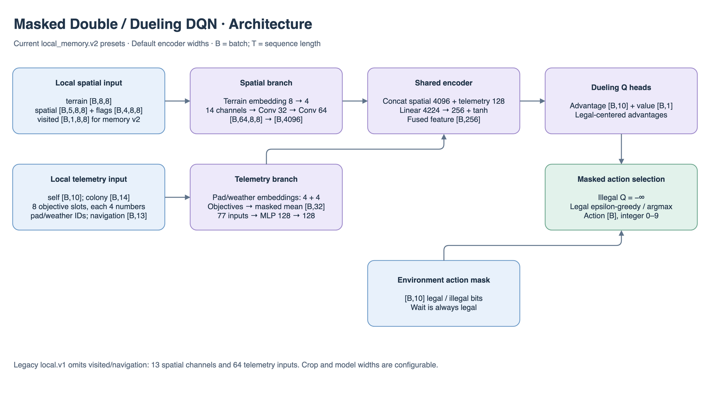
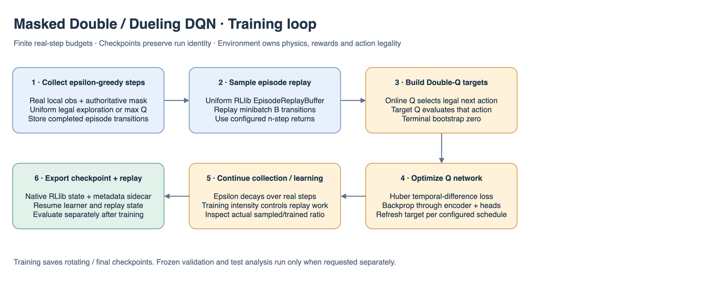

# Masked DQN details

## Architecture and learning at a glance

Dimensions in these figures describe the current `local_memory` reference presets at the default 8×8 crop and model widths. `B` is batch size; recurrent models additionally use `T` for sequence length. Smaller smoke models and YAML overrides change these widths; use `resolved_config.yaml` for a particular run. The action space remains `Discrete(10)`.

The shared encoder consumes terrain `[B,8,8]`, five numerical spatial channels `[B,5,8,8]`, four flag channels `[B,4,8,8]`, rover `[B,10]`, colony `[B,14]`, pad/weather IDs, eight objective-type slots, objective values `[B,8,4]` and objective mask `[B,8]`. `local_memory.v2` adds visited `[B,1,8,8]` and navigation `[B,13]`. Terrain embedding contributes four channels; the resulting 14-channel CNN produces 4,096 features. Embedded and pooled telemetry has 77 inputs and produces 128 features. Fusion maps 4,224 → 256. Legacy `local.v1` omits the two memory fields and uses 13 CNN channels / 64 telemetry inputs.

The dueling heads produce advantage `[B,10]` and value `[B,1]`; advantages are centered over legal actions. The final Q tensor is `[B,10]`, with illegal entries set to `-inf`. Double-Q replay targets use the next observation’s legal set.

The PNG figures contain editable draw.io XML: open the PNG directly in draw.io to revise the illustration. Shapes and numbers are grounded in the adjacent model/configuration files and `../common/encoder.py`.

**October 7, 2026 update:** new presets use `local_memory` v2, capped delivery/task rewards v2 and frozen snapshots. The shared RLlib runner saves rotating and final checkpoints without automatic evaluation, validation selection or success gates. Run evaluation separately after training. Architecture details that explicitly name `local.v1` describe the retained legacy input. See [pipeline corrections](../../../../docs/rl/pipeline_fixes_2026-10-06.md) for the current contract.

**October 8 sample-credit experiment:** `reference.yaml` now selects `seed_3_sample_credit_030`, retaining learner seed 3 and all DQN settings from seed_3. The only reward change is `samples_collected: 0.30` per 0.5 kg newly acquired, capped at the mission's sample quota. Delivered plus onboard sample mass preserves the acquisition total through Unload; the standard 4 kg quota pays at most 2.4. Excess scans and disabled sample targets pay zero; fractional remaining quotas pay proportionally. `new_scan` stays zero. This enabled reward uses shaped profile/breakdown v3; sparse evaluation and zero-default rewards retain v2. Existing outputs are rejected rather than overwritten. See the [run learnings](../../../../results/double_duelling_dqn/seed_3/learnings.md) for evidence and [launch/evaluation commands](../../../../docs/rl/usage.md).

Implementation reference for `masked_dqn` and `local_cnn_q`. Off-policy **Double Dueling DQN** (van Hasselt 2016 + Wang 2016; n-step=3 on the reference config) trains through Ray RLlib on the same Gym env, seeds, masks, and evaluation path as masked PPO.

W&B run name is `{experiment_id}-{trial_id}`. The reference trial uses `experiment_id: double_duelling_dqn`, `group: double_dueling_dqn`, and checkpoint `policy_id` `{experiment_id}:{trial_id}:{label}`. Registry name stays `masked_dqn`.

Simulator rules stay in `aresim.core` and `aresim.components`. Illegal actions are excluded from greedy selection, epsilon-greedy, and Double-DQN targets by setting those Q-values to `-inf` inside `compute_q_values`.

Live UI and action-path plots default to seeded epsilon-greedy sampling. The frozen adapter uses the checkpoint experiment's fixed `epsilon_end`: uniform legal selection with probability epsilon, highest legal Q-value otherwise. It reads `compute_q_values` directly because RLlib's inference path returns greedy actions, and never treats Q-values as categorical logits. Highest Q-value remains selectable; the manual evaluator also accepts stochastic or both modes. Training already samples epsilon-greedy actions with the full configured schedule and is unchanged.

Shared checkpoint transport, sidecar/provenance validation and native module restoration live in `../../training/rllib/checkpoint.py`. Framework-neutral loader dispatch lives in `../../training/checkpoints.py`; resume compatibility lives in `../../training/resume.py`. PPO retains its historical public checkpoint/driver aliases while each algorithm owns its policy-specific inference state.

**Source ownership**

| File | Responsibility |
|---|---|
| `config.py` | `MaskedDQNConfig`, YAML decode |
| `train.py` | `LocalMaskedQNetwork`, `AresMaskedDQNRLModule`, `MaskedDQNFactory` |
| `checkpoint.py` | `rllib_masked_dqn` loader |
| `../common/encoder.py` | Shared local CNN encoder and `mask_illegal_actions` |
| `../registry.py` | Registers `masked_dqn`, `local_cnn_q`, `rllib_masked_dqn` |

**CLI:** `aresim-rl train configs/masked_dqn/reference.yaml` (current reference: `seed_3_sample_credit_030`). Smoke: `aresim-rl train configs/masked_dqn/smoke.yaml`.

Replay is RLlib's `EpisodeReplayBuffer`. Online fragments are not `aresim.trajectory.v1` artifacts. Summary-only frozen evaluation uses the lightweight environment path; evaluation with trajectory recording uses `RolloutRunner`.

`rollout_batch_size` is environment steps per Tune iteration (`min_sample_timesteps_per_iteration`), **not** the per-runner collection length. `rollout_fragment_length` controls that collection length; `train_batch_size` is the replay minibatch. `training_intensity` requests the replay-to-new-sample ratio. RLlib rounds its sampling/training weights, so inspect `num_training_step_calls_per_iteration`, sampled steps, and trained samples in each run instead of assuming the requested ratio is exact. The checked-in smoke, dev, and reference configurations target roughly four replayed samples per new environment step. n-step is 1 in smoke/dev and 3 in the reference config. Prioritized replay, C51, and recurrence are out of scope here.

The October 7 reference configuration increases environment runners from 4 to 28, retaining one CUDA learner and a 2,097,152-step budget. On RLlib 2.58 its collection/replay weights change from `[1, 2]` to `[1, 14]`: 28×32 = 896 collected steps and 14×256 = 3,584 replayed samples, still a ratio of 4. The minimum 4,096-step reporting batch is collected in approximately 4,480-step chunks, so checkpoints every 20 reporting iterations are roughly 89,600 actual steps apart. This preset assumes a roughly 32-vCPU training host; speed depends on collection and learner bottlenecks.

The reference explicitly sets `environment.reward_overrides.time_cost: -0.025`, keeping gamma 0.995 and the −5 terminal-failure weight. This removes the failure/time-cost benefit of deferring an otherwise identical failure; it is an experimental reward change whose effect on DQN learning remains unverified. Other presets retain the default time cost. Start fresh and evaluate sampled mission success and capped deliveries after training; the trainer schedules no evaluations.

RLlib training uses the non-audit environment path: observations, masks, tasks, and rewards are unchanged, while per-step full-world checksums and the post-step state copy are omitted. Built-in actions, tasks, and reward profiles additionally capture a compact pre-step reward snapshot instead of copying the 32×32 terrain and growing history; custom components retain the full before-state fallback. The returned transition state is borrowed until the next step. Frozen summary evaluation uses the same path; recorded trajectories and the ordinary engine/API retain full checksums and defensive copies. Compare both environment steps per second and validation reward when tuning collection length or replay intensity.

RLlib's model hot path trusts the environment's CPU-side legal-mask check and skips tensor-to-Python validity checks that synchronize a GPU. Set `ARESIM_VALIDATE_MODEL_OUTPUTS=1` to enable the stricter mask checks while diagnosing a model or custom environment. Standalone Q-network validation remains strict.

October 16 ownership update: environment, metrics and Tune execution now live under `training/rllib/`; encoder dimensions live in `algorithms/common/model_config.py`. Feedforward DQN defaults and sidecar format are unchanged. [Recurrent DQN](../recurrent_dqn/DETAILS.md) is a separate algorithm with LSTM sequence replay, burn-in, and seeded replay checkpoints.
