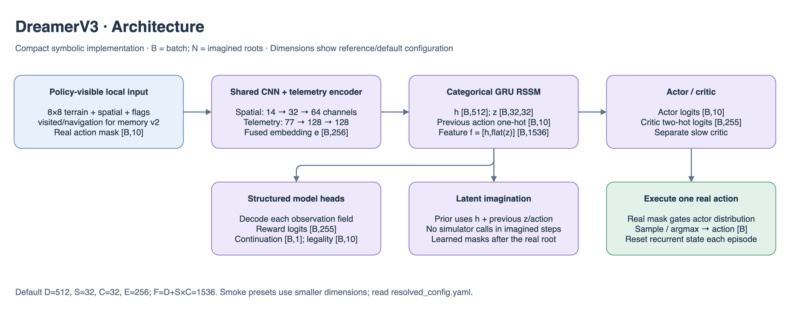
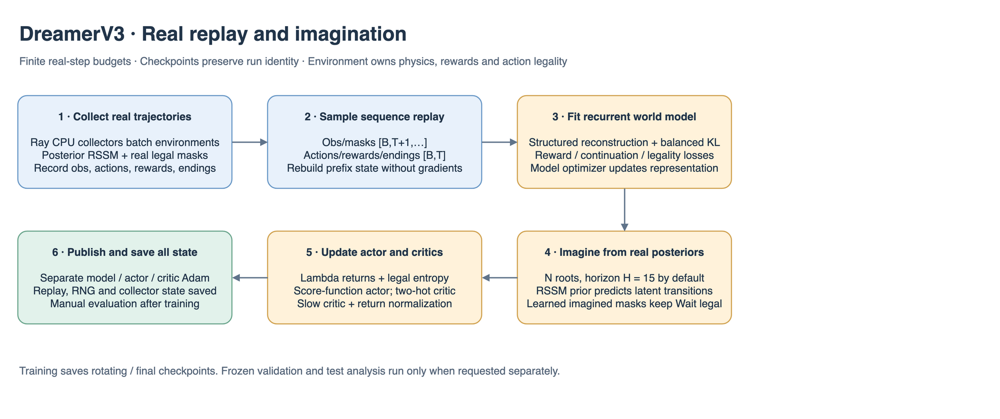

# DreamerV3 details

## Architecture and learning at a glance

Dimensions in these figures describe the current `local_memory` reference presets at the default 8×8 crop and model widths. `B` is batch size; recurrent models additionally use `T` for sequence length. Smaller smoke models and YAML overrides change these widths; use `resolved_config.yaml` for a particular run. The action space remains `Discrete(10)`.

The shared encoder consumes terrain `[B,8,8]`, five numerical spatial channels `[B,5,8,8]`, four flag channels `[B,4,8,8]`, rover `[B,10]`, colony `[B,14]`, pad/weather IDs, eight objective-type slots, objective values `[B,8,4]` and objective mask `[B,8]`. `local_memory.v2` adds visited `[B,1,8,8]` and navigation `[B,13]`. Terrain embedding contributes four channels; the resulting 14-channel CNN produces 4,096 features. Embedded and pooled telemetry has 77 inputs and produces 128 features. Fusion maps 4,224 → 256. Legacy `local.v1` omits the two memory fields and uses 13 CNN channels / 64 telemetry inputs.

The default posterior state has deterministic `h=[B,512]` and categorical `z=[B,32,32]`, giving feature width `512+32×32=1536`. The actor emits `[B,10]`; critic/reward heads emit 255 two-hot support logits per row, while continuation and legality emit one and ten logits. Replay has `T+1` observations for `T` real transitions. Imagined learning uses horizon 15 by default.





The PNG figures contain editable draw.io XML: open the PNG directly in draw.io to revise the illustration. Shapes and numbers are grounded in the adjacent model/configuration files and `../common/encoder.py`.

Updated October 16, 2026. Algorithm `dreamerv3`, model `local_rssm`, loader `torch_dreamerv3`; install `aresim[world_models]`. This is a compact symbolic PyTorch adaptation, not a published benchmark reproduction.

## Files and tensor flow

| Owner | Responsibility |
|---|---|
| `config.py` | Typed learning/model/resource settings without numerical framework imports |
| `model.py` | Structured observation encoder/decoder, categorical GRU RSSM, reward/continuation/legality heads |
| `distributions.py` | Straight-through categories, legal actor mixing, symlog/symexp support and lambda returns |
| `behavior.py` | Independent actor/critic, slow critic and return-percentile state |
| `train.py` | Registered factory; delegates to the shared runner |
| `checkpoint.py` | Versioned sidecar, inventory validation, batched recurrent actor and frozen CPU loader |
| `../../training/world_models/` | Sequence replay, isolated learner updates, bounded Ray collectors, lifecycle/transfer/resume |

Replay has observations/masks `[B,T+1,...]`, actions/rewards/endings `[B,T]`, and independent valid masks. The CNN operates on flattened observations; the RSSM consumes the time axis with previous action and posterior observation embedding. Its deterministic state is `[B,D]`, stochastic state `[B,S,C]`, and concatenated feature `[B,D+S*C]`. A no-previous-action sentinel maps to an all-zero action vector.

A sampled episode prefix reconstructs initial recurrent state without gradients. Reconstruction, balanced/free-nat categorical KL, learned legality, incoming-transition reward and nonterminal prediction train the model. The decoder uses categorical, binary, or symlog squared losses according to field semantics and excludes inactive objective content/padding.

Imagined roots come from real posterior states. The actor/critic learn on `[N,H,...]` latent trajectories using lambda returns, score-function actor gradients, legal entropy, robust return scaling and two-hot critics. Model parameters receive no behavior gradients. Task behavior also has a masked real-replay critic term. Separate model, actor and critic Adam optimizers and slow-value/normalizer state are saved.

## Constraints and execution

The real root mask is authoritative. Subsequent imagined masks come from the legality head with Wait enabled; uniform actor mixing stays within that legal set. True termination stops bootstrap; time-limit truncation retains the real final observation. Deterministic evaluation uses modal categories plus actor argmax; stochastic evaluation seeds latent/action streams separately.

Ray CPU actors batch policies across their environments using immutable wave snapshots. The driver learns on one device after deterministic-order ingestion. Active histories are rebuilt at weight publication; raw prefixes are retained in replay. This correctness-first full-prefix reconstruction has linear episode-length cost; profile it before scaling.

## Commands and artifacts

```bash
engine/.venv/bin/aresim-rl train configs/dreamerv3/smoke.yaml
engine/.venv/bin/aresim-rl train configs/dreamerv3/smoke.yaml \
  --set algorithm_config.total_environment_steps=512 --resume-from .
engine/.venv/bin/aresim-rl evaluate results/dreamerv3_smoke_v1/seed_7 --checkpoint final --action-mode both
```

Exports use `aresim.checkpoint.world_model.v1`, `native/model.pt`, and trusted `native/trainer.pt`. Trainer state includes replay, optimizers, slow critic/normalizers, RNGs, counters/credit, collector snapshots and active episodes. Quiescent CPU partial-episode resume was checked against uninterrupted training exactly. Frozen inference loads only model weights and does not import Ray/RLlib. Training never evaluates or selects on held-out data.

See the [implementation guide](../README.md) for field loss definitions, numerical settings, memory/mask semantics, UI integration, deviations, resource presets and verification limits.

## Training performance — November 7, 2026

See the [measured pipeline optimizations and GPU benchmark commands](../../../../docs/rl/training_performance.md). Search/learning budgets and model widths are unchanged; CPU component timings do not establish CUDA throughput. Native checkpoint formats are preserved.
