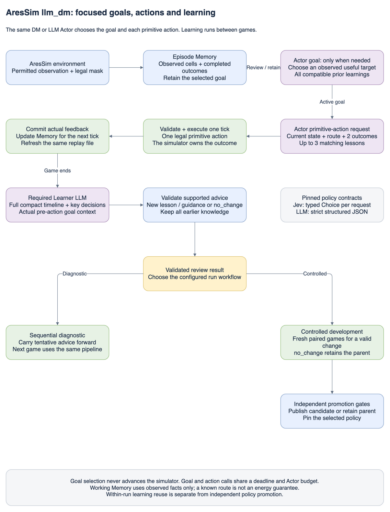
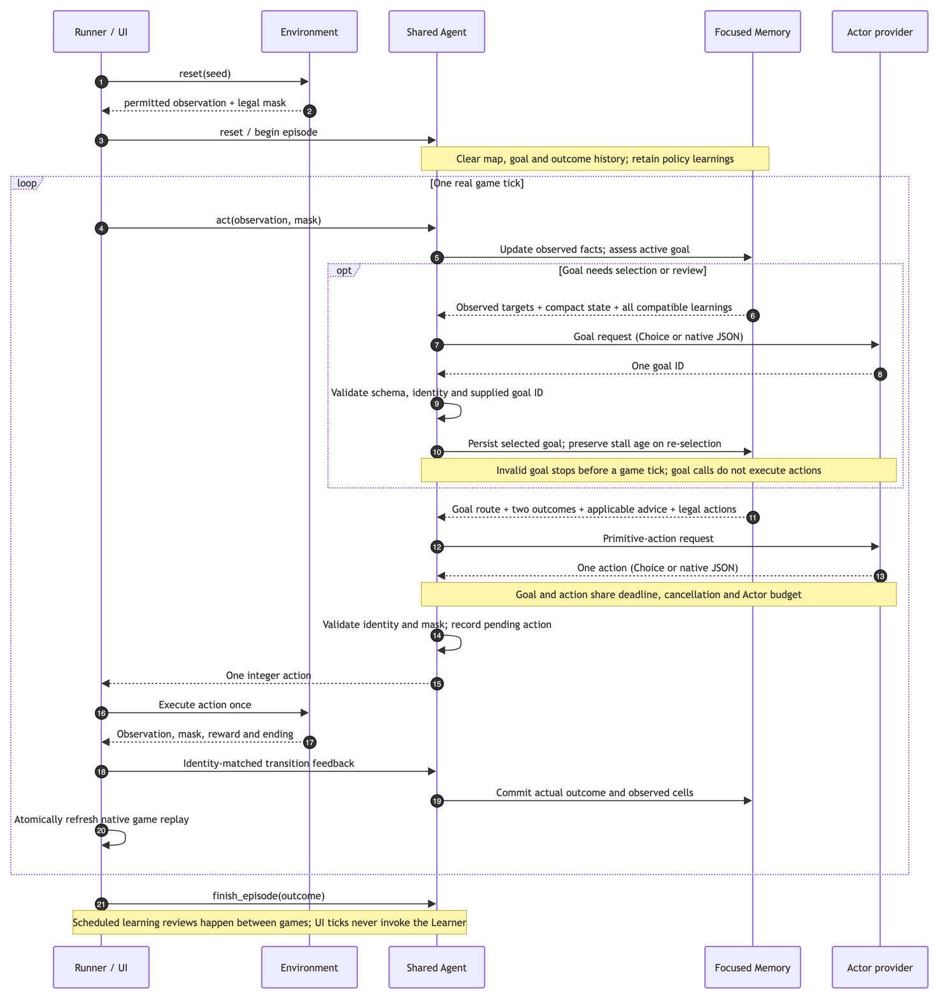
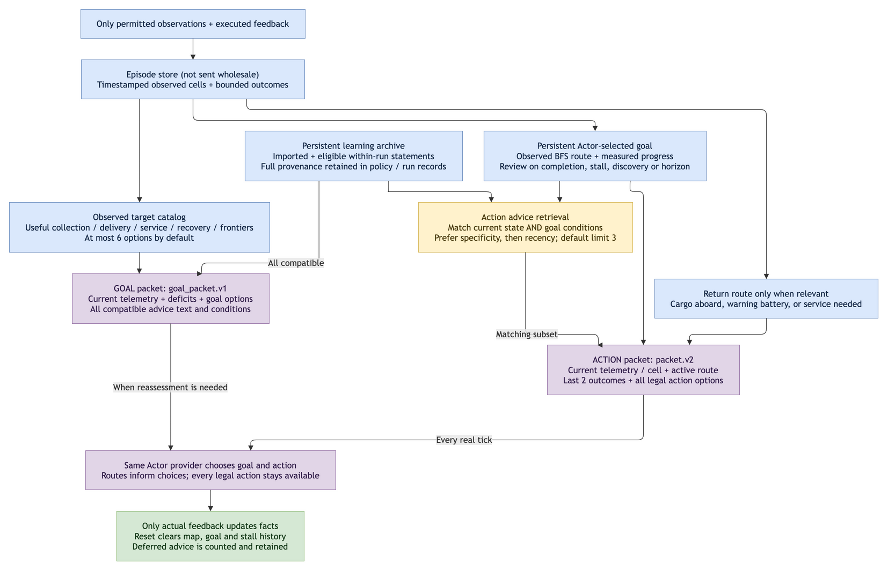
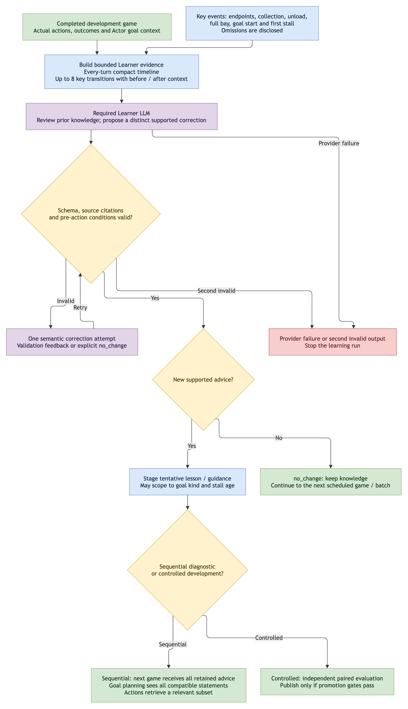
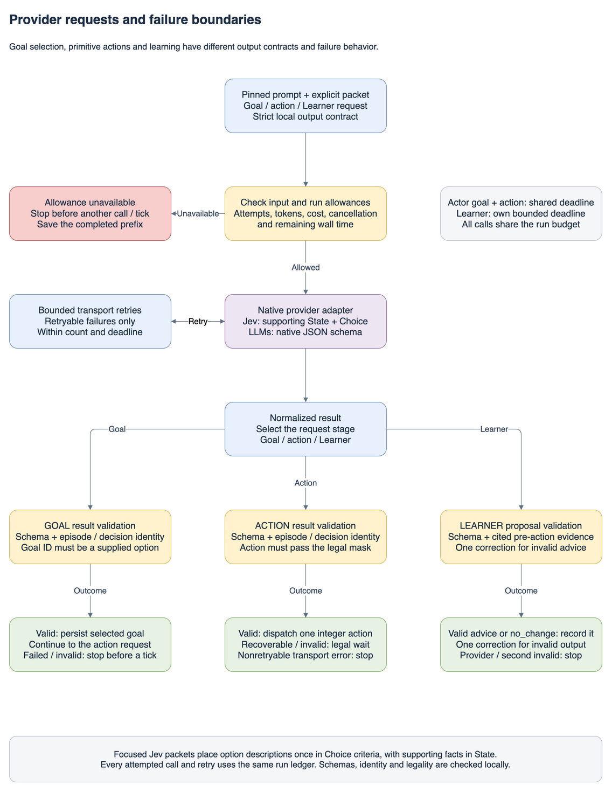
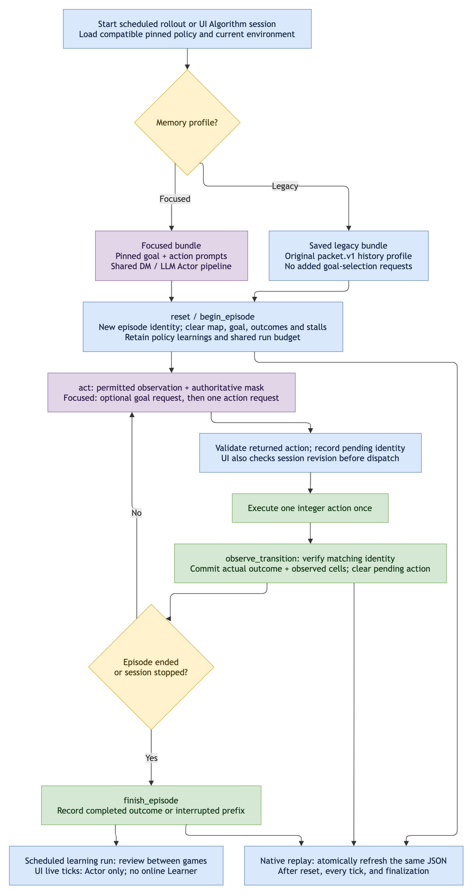
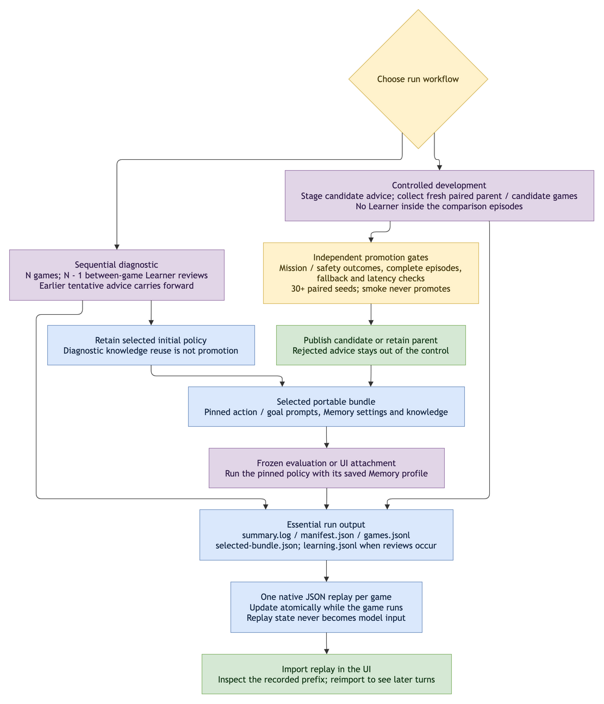

# llm_dm: Actor, Memory and LLM Learner

`llm_dm` runs a Decision Model or LLM Actor against the same permitted rover observations, episode Memory and persistent learning context. A required LLM Learner reviews completed games and proposes advice for later games. Learning changes prompt knowledge; it does not update model weights.

The simulator owns action legality, execution, rewards and termination. Neither role receives hidden world state.

## Architecture



The seven PNG diagrams in `diagrams/` embed editable draw.io XML; open a PNG directly in draw.io to edit it. They cover architecture, the per-tick sequence, focused Memory, the mandatory Learner, provider failures, episode/UI lifecycle, and evaluation/replay. Goal-selection arrows represent model calls; only action execution advances the game. Numeric limits shown are configurable defaults.

| Component | Responsibility | Source |
|---|---|---|
| Actor | Select a persistent observed goal when needed, then choose one legal primitive action per tick | [agent.py](agent.py) |
| State | Encode policy-visible observations with named fields and units | [state.py](state.py) |
| Memory | Retain timestamped observed cells and completed transitions within one game | [memory.py](memory.py) |
| Focused working memory | Build observed target options, retain the Actor-selected goal, route through known cells and retrieve applicable advice | [focus.py](focus.py) |
| Input packet | Share focused goal/action packets across both Actor types; retain the full-context compatibility profile | [agent.py](agent.py), [decision_context.py](../common/decision_context.py) |
| Learner | Propose bounded advice with actual evidence references, or `no_change` | [learner.py](learner.py) |
| Knowledge | Pin imported, tentative and active advice to immutable policy bundles | [knowledge.py](knowledge.py) |
| Providers | Translate native HTTPS requests and normalize responses | [providers/http.py](providers/http.py) |
| Orchestration | Schedule games, reviews, comparisons and selected policy output | [rollout.py](rollout.py) |
| Budgets | Reserve input/output, attempts, cost and time across both roles | [budget.py](budget.py), [calls.py](calls.py) |
| Artifacts | Write essential records, readable summaries and progressive replays | [artifacts.py](artifacts.py), [reporting.py](reporting.py) |

## Actor choices and input contract

The current Decision Model provider is TypeSafe Jev, selected with `actor.provider: decision_models` and `output_mode: choice`. LLM Actors use `openai`, `deepseek`, `anthropic`, `gemini` or `openrouter` with `output_mode: native_schema`. The Learner must use an LLM provider; Decision Models cannot act as Learners. `transport: fake` supplies deterministic offline responses for pipeline verification.

Both Actor paths default to `history.mode: focused`, with two bounded request types:

1. `aresim.llm_dm.goal_packet.v1`: compact telemetry, remaining delivery/collection kg, current working memory, a small diverse set of observed reachable goals, and all compatible learning statements without repeated provenance. The Actor chooses one goal; this request does not advance the simulator.
2. `aresim.llm_dm.packet.v2`: current telemetry/current cell, persistent selected goal and observed route, the last two executed outcomes, measured stall counters, all legal primitive actions and a bounded view of condition-matched advice. Visible map dumps, old telemetry snapshots and supporting source IDs stay outside the action prompt.

Observed goals include needed ice/samples, unexplored frontiers and useful delivery/service/recovery tasks. Known routes use breadth-first search over previously observed passable cells. Their first-hop choices are geometry facts, not energy guarantees or action overrides. A goal persists until completion, invalidation, newly discovered collection opportunities, a battery warning, stalled progress or the configured review horizon. Re-selecting the same goal does not erase its stall record. Goal and action requests share the tick deadline, cancellation signal and Actor budget.

Legacy `none`, `recent` and `facts_recent` profiles retain `aresim.llm.packet.v1`: full observed State, bounded History, all learnings and condition-matched lessons. Saved pre-focused bundles retain this protocol and do not acquire goal requests. The diagrams describe the focused workflow, including optional goal selection before an action. The lifecycle diagram also shows the legacy bundle branch.

Jev returns one typed Choice. Its adapter supplies the matching decision identity and normalizes the result into the same internal action JSON used by an LLM Actor. The shared Agent then checks schema, identity and legality. Legal choices pass through regardless of confidence; there are no forced collection priorities or random second-choice substitutions.

All Actors ultimately return one integer: `0` Wait, `1–4` north/east/south/west, `5` Scan, `6` Extract, `7` Build, `8` Service, `9` Unload.



## Memory and input limits

`LLMDMAgent` implements the shared `Agent` and `TransitionAwareAgent` contracts. `act` creates one pending decision. Only identity-matched `observe_transition` feedback updates Memory; proposing a move does not prove that it happened. `finish_episode` closes the recorded outcome. Reset clears map coordinates and transition history for the new world while retaining the policy's learning statements.

Focused Memory keeps the complete episode-local observed map internally, while exposing only task-relevant working context. A return route appears when carrying cargo, at warning battery, or when service is needed. Healthy, empty exploration does not receive a repeated home-distance attraction. Adjacent movement options include observed terrain/resources, route membership, recent visits and immediate reversal; every legal action remains available. TypeSafe receives option descriptions once in Choice criteria, with supporting facts in State.

Configure `history.goal_horizon` (default 8), `stall_steps` (6), `target_limit` (6), and `advice_limit` (3). `history.max_bytes` bounds the focused working-memory view; old recent outcomes can be omitted, but a goal envelope that cannot fit stops explicitly. `recent_limit` bounds retained outcome history. Legacy profiles use `fact_limit` and `max_bytes` for retrieved history, fitting optional history to the remaining whole-request allowance.

All learning statements remain in the policy. Goal selection receives all compatible statements with text and conditions. Actions receive up to `advice_limit` matching statements, preferring more specific conditions and then newer advice. Deferred advice is counted; it is not deleted. New Learner conditions can use `decision.goal_kind` and `decision.goal_steps_without_progress`, recorded as pre-action facts, to scope advice to the goal or stall where it matters. Missing facts never match a condition.

`max_input_tokens` currently uses a conservative UTF-8-byte estimate plus fixed overhead, rather than the provider's tokenizer. A genuinely oversized required context still stops before a provider attempt. The summary and manifest record the reservation and limit; input allowance failures are distinct from spending limits and provider errors.



## Learner workflow and knowledge reuse

In `sequential_diagnostic`, the sequence is game 1 → LLM review → game 2 with prior advice → LLM review → subsequent games. N scheduled games require N−1 between-game reviews. Every earlier distinct statement remains available for later goal selection, with applicable advice retrieved for actions; `no_change` preserves existing statements. The Learner sees prior knowledge and a compact full-game timeline. Up to eight detailed transitions cover endpoints and the first collection, unload, full-bay, goal-start and stall events, including the actual observed goal/action context. It must propose a distinct supported correction or return `no_change`, rather than restating existing advice. It never sees future game outcomes. Proposal conditions must match at least one cited pre-action state; `condition_support` records this coverage. The mission remaining-fraction aliases refer to delivery quotas, not cargo collection. Invalid proposals receive at most one correction attempt, with feedback recorded in `learning.jsonl`; a second invalid output stops the run. This may add a model request to a review, but never adds a game or bypasses shared budgets.

**Reuse is separate from promotion.** Diagnostic runs carry tentative advice forward without publishing a validated policy. “No promotion” does not mean forgotten, and “0 condition matches” does not mean no learning context: inspect `learning_statement_count`, `goal_selections`, `learning_context_decisions`, and per-action advice/deferred counts. In focused mode, zero action matches can coexist with all statements being supplied at goal selection. Prompt exposure alone does not prove the advice was followed or beneficial.

Controlled `development` runs compare parent and candidate policies on independent paired seeds before promotion. Rejected advice does not contaminate the control. `smoke` exercises this flow without publication. Explicit `frozen_evaluation` and `actor_ablation` modes run a saved policy without online learning; the UI never calls a Learner inside a live tick.

Top-level `learnings_file` imports a previous `learning.jsonl` or curated JSONL statements. The shared loader extracts validated proposals, deduplicates advice and excludes evidence, failed output and `no_change` explanations. Imported statements are snapshotted once, with source references, and appear from the first game onward for either Actor type.



## Configuration and commands

| Config | Purpose |
|---|---|
| [10-games.yaml](../../../../configs/llm_dm/10-games.yaml) | Jev Actor and GPT-6 Luna Learner; edit the explicit episode list to choose the game count |
| [llm-actor.yaml](../../../../configs/llm_dm/llm-actor.yaml) | Alternate LLM Actor profile using the same pipeline |
| [fake_smoke.yaml](../../../../configs/llm_dm/fake_smoke.yaml) | Offline Actor/Memory/Learner/evaluation smoke |
| [frozen.yaml](../../../../configs/llm_dm/frozen.yaml) | Saved-policy evaluation and UI attachment |
| [prices.json](../../../../configs/llm_dm/prices.json) | Dated provider/model rates for budget reservations |

Name runs using top-level `experiment_name`. Outputs go to `output_directory/experiment_name/`; subsequent runs with that name get `-002`, `-003`, and so on. Neither the experiment name nor the config filename sets the number of games: the `episodes` list does.

The Jev Actor uses `JEV_API_KEY`; the OpenAI Learner uses `OPENAI_API_KEY`. Set them locally in `.env.local`. `--env-file` reads configured credential names without executing shell content or saving credential values to artifacts.

From the checkout root, with the `llm_dm` extra installed:

```bash
# Offline pipeline verification.
engine/.venv/bin/aresim-rl rollout configs/llm_dm/fake_smoke.yaml

# Jev Actor + GPT-6 Luna Learner.
engine/.venv/bin/aresim-rl rollout configs/llm_dm/10-games.yaml --env-file .env.local

# LLM Actor + LLM Learner.
engine/.venv/bin/aresim-rl rollout configs/llm_dm/llm-actor.yaml --env-file .env.local
```

Actor and Learner profiles independently configure model, provider, credentials, generation, input/output limits, attempt timeout, deadline and guidance. [config.py](config.py) validates them. [prompts.py](prompts.py) injects public game requirements into the [focused Actor](prompts/actor_focused.txt), [goal selector](prompts/goal.txt), [legacy Actor](prompts/actor.txt) and [Learner](prompts/learner.txt) templates. `actor.prompt_path` and `actor.goal_prompt_path` independently override the action and goal templates; both are frozen into focused bundles. The Actor output requirements render as either a Choice or strict JSON contract.



## Compare LLM Actor+Learner models

Edit the `models` list in [llm_dm_models.yaml](../../../../configs/evaluation/llm_dm_models.yaml), then run [evaluate_llm_models.py](../../../../scripts/evaluate_llm_models.py):

```bash
engine/.venv/bin/python scripts/evaluate_llm_models.py --config configs/evaluation/llm_dm_models.yaml --env-file .env.local
```

Each entry is used as both Actor and Learner on the same five declared worlds, with four between-game reviews. The evaluation config is derived from the main run profile; the script writes an independent resolved config per model and leaves the original untouched. Generation settings are reset per provider, with optional shared and per-role overrides. Knowledge is isolated between models. This is a sequential adaptation comparison rather than held-out frozen-policy evaluation.

The panel checks all selected models' credentials and prices before paid calls. Add `--dry-run` to inspect resolved configs without calling models, or `--fake --max-episode-steps 6` for an offline simulator smoke. Repeat `--model provider/model` to select configured entries. Additional models need explicit rates in the price sheet or their optional `pricing` entry. Budgets are per model; the default three-model panel permits at most $15 total.

The named panel folder under `results/reports/llm_dm/` contains `summary.json`, `episodes.csv`, a price snapshot and resolved configs. Its `runs/` folder retains each model's usual artifacts and native replays. The comparison records shaped, engine and sparse rewards; exact ice/sample collection and delivery; seeds; endings; actions; learning exposure; model usage; cost estimates; and source/environment metadata. Reports refresh after each model, preserve incomplete outcomes and survive interruption. Missing rewards for unfinished replay prefixes remain unknown rather than being reported as zero.

## Output and replay workflow

Start with `summary.log`. A learning run keeps five primary files and one native replay per game. Frozen runs without learning records can omit `learning.jsonl`:

| Artifact | Read it for |
|---|---|
| `summary.log` | Outcomes, deliveries, Learner proposals, knowledge exposure, budget/history limits and game milestones |
| `manifest.json` | Resolved setup, prompts, usage/cost totals, policy versions and replay index |
| `games.jsonl` | Compact actual-turn telemetry, proposed/issued/effective actions, fallbacks, Actor details, goal selections, active goals, advice exposure and history omissions |
| `learning.jsonl` | Supplied evidence, validated proposals, no-change/failure records and evaluation/publication decisions |
| `selected-bundle.json` | Portable selected policy, exact action/goal prompts, Memory profile and imported learnings |
| `replays/*.json` | UI-importable games, written at reset, replaced atomically each tick and finalized in place |

`debug_trace: true` additionally saves exact per-call content in one compressed `debug.jsonl.gz`. It is off by default. A running replay can be imported to inspect its recorded prefix; reimport later to see additional ticks.

For UI Algorithm mode, set backend `ARESIM_LLM_DM_CONFIG` to a compatible frozen-evaluation config. The public algorithm ID is `llm_dm`, policy ID is `aresim.agent.llm_dm.v1`, capability is `llm_dm`, and step metadata is `llmDm`. The existing `aresim.llm.*.v1` wire schemas are retained for saved-data compatibility.





## Verification

Use manual real-simulator smoke runs with fake or intercepted provider responses. Check both Actor paths, identical shared input structure, completed-transition-only Memory, reset isolation, preserved learning context, legal output enforcement, bounded history, Learner change/no-change behavior, progressive replay import and frozen UI attachment. Offline verification establishes pipeline behavior; live model performance and learning benefit require a separately bounded experiment.
