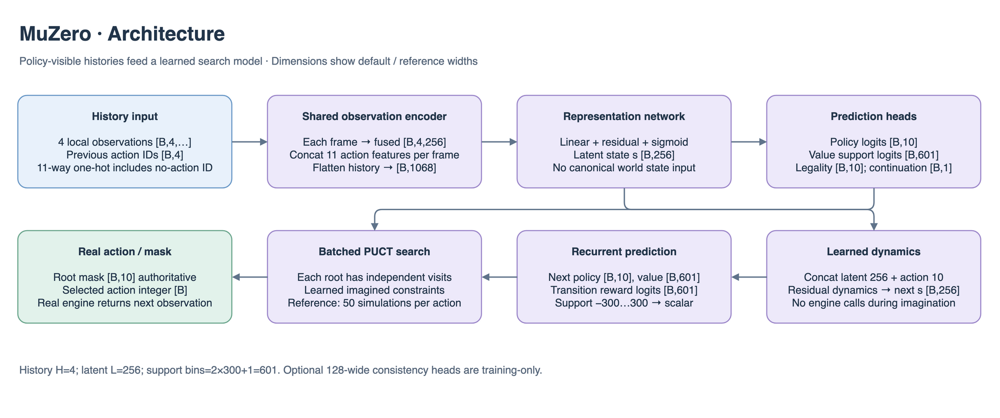
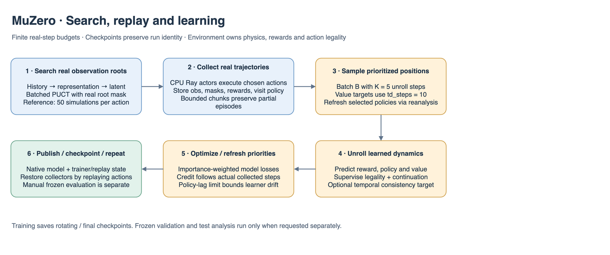

# MuZero details

## Architecture and learning at a glance

Dimensions in these figures describe the current `local_memory` reference presets at the default 8×8 crop and model widths. `B` is batch size; recurrent models additionally use `T` for sequence length. Smaller smoke models and YAML overrides change these widths; use `resolved_config.yaml` for a particular run. The action space remains `Discrete(10)`.

The shared encoder consumes terrain `[B,8,8]`, five numerical spatial channels `[B,5,8,8]`, four flag channels `[B,4,8,8]`, rover `[B,10]`, colony `[B,14]`, pad/weather IDs, eight objective-type slots, objective values `[B,8,4]` and objective mask `[B,8]`. `local_memory.v2` adds visited `[B,1,8,8]` and navigation `[B,13]`. Terrain embedding contributes four channels; the resulting 14-channel CNN produces 4,096 features. Embedded and pooled telemetry has 77 inputs and produces 128 features. Fusion maps 4,224 → 256. Legacy `local.v1` omits the two memory fields and uses 13 CNN channels / 64 telemetry inputs.

Four encoded frames concatenate their 256-wide features with 11-way previous-action vectors (including the no-action sentinel), producing `4×(256+11)=1068` representation inputs. The learned latent is `[B,256]`; dynamics takes 266 inputs after concatenating an action. Policy and legality heads have ten outputs; value and transition-reward heads have `2×300+1=601` support logits. The reference uses 50 PUCT simulations, five training unroll steps and an optional 128-wide training-only consistency projection.





The PNG figures contain editable draw.io XML: open the PNG directly in draw.io to revise the illustration. Shapes and numbers are grounded in the adjacent model/configuration files and `../common/encoder.py`.

`muzero` trains a learned search model for the existing single-rover `aresim.obs.local_memory.v2` and `aresim.action.rover.v1` contracts. The deterministic simulator owns real transitions, rewards, masks and episode endings. MCTS uses the learned model for hypothetical transitions. The UI and action-path script default to seeded sampling from noise-free evaluation visits; training samples visits with Dirichlet root noise.

## Reference readiness — October 13, 2026

The reference now uses **eight Ray Core CPU collectors with four environments each and one CUDA learner**. Batched search and replay reanalysis retain 50 simulations/action, gamma 0.995, five dynamics unrolls, TD length 10, 2,097,152 real steps and 0.1 updates/step. Default replay batch size is 32. The fresh trial is `seed_7_sample_credit_030_learning_v3`; reward settings remain −0.025 time cost and quota-capped +0.30 sample acquisition credit. The mission remains 12 kg ice / 4 kg samples with an 800-step limit.

The [implementation and A30 comparison](../../../../docs/rl/muzero_parallel_2026-10-11.md) document the resource controls, timing evidence, partial-episode resume and deployment correction. The saved serial implementation measured 13.52 steps/s versus 111.26 steps/s for Ray collection, about 8.2× faster, in bounded same-A30 runs using batch 256/eight driver threads. This verifies execution speed, not mission-learning quality or a guaranteed long-run rate. A full-budget held-out learning comparison remains pending.

Checkpoints rotate every 81,920 requested environment steps, after a collection wave completes, retaining three intermediate snapshots plus final. Completed replay and unfinished collector trajectories are saved with optimizer, RNG and counters. Changed source/resource settings require a fresh trial; historical checkpoints remain available for compatible frozen inference. Training performs no automatic validation, baseline or final evaluation. Replay reanalysis is part of learning.

The [October 13 corrections](../../../../docs/rl/muzero_learning_fixes_2026-10-13.md) make numbered checkpoint rotation/resume numeric and normalize importance-weighted loss by the sum of weights. Unweighted loss and replay-weight diagnostics are exported by manual reports. The completed earlier parallel run reached 116 steps/s but 0/32 full missions in both sampled and greedy analysis; the completed loss-normalized run also achieved no full missions. The [learning-path follow-up](../../../../docs/rl/muzero_learning_v3_2026-10-13.md) adds targeted full-unroll reanalysis, positive legality weighting and stopped-target temporal consistency. Local checks and tiny Ray resume passed; the temporary A30 was destroyed before training at the user's request. CUDA throughput and task acceptance for this version remain unverified.

## Install and run

Install `./engine[muzero]`, which includes PyTorch, environment packages, W&B and Ray Core 2.58. RLlib/Tune are not required by MuZero. From the repository root:

```bash
engine/.venv/bin/aresim-rl train configs/muzero/smoke.yaml
engine/.venv/bin/aresim-rl train configs/muzero/dev.yaml
engine/.venv/bin/aresim-rl train configs/muzero/reference.yaml
```

Smoke uses a small CPU model, two simulations and 16-step episodes; dev uses CPU and open exploration. Both use one Ray CPU collector with one environment. Ray is the only training collection implementation; there is no backend selector. Reference uses parallel CPU collection and CUDA learning. Online tracking requires W&B authentication.

The user's larger-batch cloud command uses the same parallel reference:

```bash
python3 scripts/jarvislabs/cloud_train.py run --gpu A30 --region IN2 \
  --config configs/muzero/reference.yaml \
  --set algorithm_config.batch_size=256 \
  --set resources.torch_threads=8 --detach
```

## Data flow and ownership

1. `model.py` represents four local observations and their preceding actions, predicts policy/value, and learns latent transitions, rewards, legality and continuation. Missing history uses the initial observation and no-action ID 10. Reward/value retain categorical scalar supports. Optional projection/prediction heads supervise temporal consistency against recorded future histories.
2. `search.py` owns PUCT. `search_many` batches independent roots and leaf expansions while keeping masks, random streams, value normalization and visit counts separate. Real roots use canonical masks; imagined nodes use learned constraints with Wait always valid. Predicted terminals stop expanding and bootstrap zero. No hypothetical node reads simulator state.
3. `collection.py` owns real environments, chunking and collector lifecycle in `RayCollectionPool`. Ray actors use CPU model snapshots. One immutable version and one pending chunk per collector keep queues bounded. Each collector owns independent seeded exploration RNGs and retains partial episodes between chunks.
4. `replay.py` stores completed trajectories and optional per-position policy versions. `train.py` samples prioritized positions, packs histories once per batch, learns from real rewards/constraints, refreshes priorities, and refreshes selected actual-minibatch unroll targets with batched noise-free reanalysis before learning. Positive rare-action legality weights and stopped-target consistency augment the objective; target age, label counts and auxiliary losses are reported. True terminals have zero bootstrap; time limits use the final observation.
5. The driver counts actual real steps and pays `floor(steps * updates_per_environment_step)` updates after replay warmup. While collection remains pending, learner advance is capped by `max_policy_lag_updates`; after a wave finishes, earned eligible credit is drained before the next snapshot. Collection can overlap learning without reducing the requested replay work.

Ray collectors reserve `collector_torch_threads` CPUs each and no GPU. The default requires eight available Ray CPUs. `num_envs_per_collector` controls inference batching; `collection_steps_per_env` bounds chunk length. Actor timing sums represent aggregate work and can exceed wall time. Metrics report effective inference batch size, search expansion counts, actual updates/step, policy lag and unfinished trajectory steps.

## Artifacts, resume and inference

Each run writes `resolved_config.yaml`, `manifest.json`, `status.json`, rotating checkpoints and final. Sidecars retain `aresim.checkpoint.muzero.v1` and `torch_muzero`; `native/model.pt` serves frozen inference. `native/trainer.pt` contains replay, optimizer, driver RNG/counters and collector RNG/unfinished histories. Resume resets saved environment seeds, replays real actions to rebuild simulator and observation memory, checks saved observations/masks, then republishes learner weights. CUDA RNG byte states restore from CPU.

```bash
engine/.venv/bin/aresim-rl train configs/muzero/smoke.yaml \
  --set algorithm_config.total_environment_steps=96 --resume-from .

# Separate manual analysis: greedy plus configured sampled repeats per map.
engine/.venv/bin/aresim-rl evaluate \
  results/muzero/seed_7_sample_credit_030_learning_v3 \
  --checkpoint final --split validation --action-mode both
```

New training configs reject the retired backend selector; historical frozen checkpoint metadata can still be read for inference. Resume permits extending only the total step budget; the remaining frozen contract must match. Owned Ray actors/runtime close on exit, while a caller-owned runtime stays available. Training never selects a best checkpoint or rolls out held-out seeds. Evaluation creates `evaluation/` only when requested separately.

In the UI select **MuZero** and provide the absolute `checkpoint.json` path. Inference needs the MuZero model dependencies but does not start Ray or restore collectors. W&B uses the existing real-step axis. The config folder retains only smoke, dev and reference; there are no new temporary presets.

## Training performance — November 7, 2026

See the [measured pipeline optimizations and GPU benchmark commands](../../../../docs/rl/training_performance.md). Search/learning budgets and model widths are unchanged; CPU component timings do not establish CUDA throughput. Native checkpoint formats are preserved.
