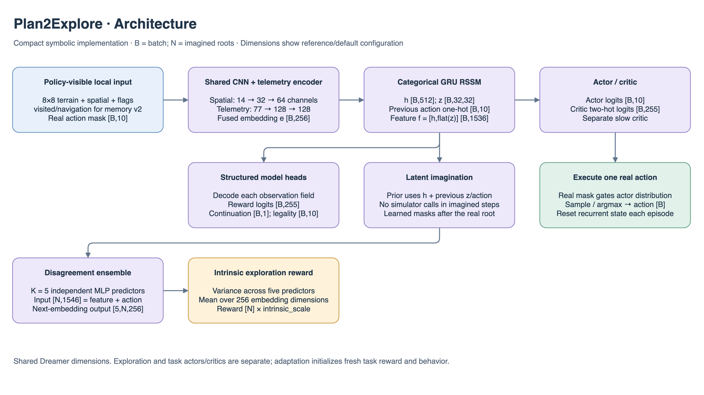
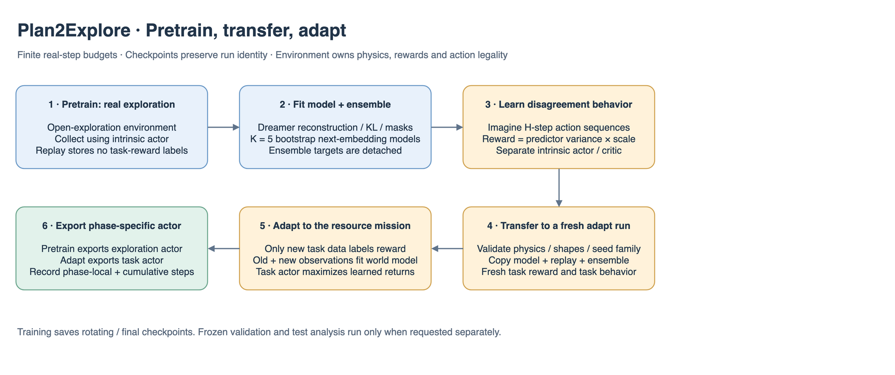

# Plan2Explore details

## Architecture and learning at a glance

Dimensions in these figures describe the current `local_memory` reference presets at the default 8×8 crop and model widths. `B` is batch size; recurrent models additionally use `T` for sequence length. Smaller smoke models and YAML overrides change these widths; use `resolved_config.yaml` for a particular run. The action space remains `Discrete(10)`.

The shared encoder consumes terrain `[B,8,8]`, five numerical spatial channels `[B,5,8,8]`, four flag channels `[B,4,8,8]`, rover `[B,10]`, colony `[B,14]`, pad/weather IDs, eight objective-type slots, objective values `[B,8,4]` and objective mask `[B,8]`. `local_memory.v2` adds visited `[B,1,8,8]` and navigation `[B,13]`. Terrain embedding contributes four channels; the resulting 14-channel CNN produces 4,096 features. Embedded and pooled telemetry has 77 inputs and produces 128 features. Fusion maps 4,224 → 256. Legacy `local.v1` omits the two memory fields and uses 13 CNN channels / 64 telemetry inputs.

The shared RSSM feature has width 1,536. Concatenating a 10-way action gives each disagreement predictor 1,546 inputs. Five independently bootstrapped MLPs predict the next 256-wide encoder embedding, producing `[5,N,256]` for `N` imagined roots. Variance across predictors, averaged over embedding dimensions, yields intrinsic reward `[N]`. The two phases export different actors as shown below.





The PNG figures contain editable draw.io XML: open the PNG directly in draw.io to revise the illustration. Shapes and numbers are grounded in the adjacent model/configuration files and `../common/encoder.py`.

Updated October 16, 2026. Algorithm `plan2explore`, model `local_rssm_disagreement`, loader `torch_plan2explore`; install `aresim[world_models]`. This ports the disagreement exploration mechanism onto AresSim's masked symbolic DreamerV3 implementation.

## Owners and objective

`config.py` owns phase/initializer/ensemble settings; `ensemble.py` owns independently bootstrapped next-embedding predictors. `train.py` validates phase/task pairing. `checkpoint.py` gives the shared loader a distinct identity. Dreamer owns RSSM, decoder, numerical losses and behavior modules; `training/world_models/` owns shared collection, replay and lifecycle.

Five independent predictors take `[RSSM feature, one-hot action]` and predict the detached next encoder embedding. Inputs are `[N,F+10]`, outputs `[K,N,E]`. Intrinsic reward is sample variance over K predictor means, averaged over E embedding dimensions and multiplied by `intrinsic_scale`. Each member learns from independent bootstrap resampling. Predictor gradients never update the encoder/RSSM.

The exploration actor/critic maximizes disagreement on imagined candidate actions. It is a separate behavior with its own critic/slow critic/return normalization. This is not RLlib's curiosity flag or simply a real-step novelty bonus mixed into task reward.

## Phase contracts

| Phase | Task | Learns / exports |
|---|---|---|
| `pretrain` | `open_exploration` | Model, legality, physical continuation, ensemble and intrinsic actor/critic; exports exploration actor |
| `adapt` | `resource_mission` | Transferred world model plus fresh task reward predictor and task actor/critic; exports task actor |

Pretrain replay stores no task-reward labels. Changing task rewards under fixed observations/RNG leaves training updates unchanged, as checked locally. Mission success is neither a pretraining stop condition nor a checkpoint selection criterion. Existing observations retain mission telemetry, so no unseen-task/task-agnostic generalization is claimed.

Adaptation validates physics, model dimensions, observation/action contracts, episode limit, gamma, ensemble size and frozen seed family. It copies shared model/replay and preserves ensemble/exploration weights for inspection, while resetting task behavior/reward/optimizers. Transferred replay has unavailable task labels; only new task data supervises reward, task continuation and replay value. Both old/new observations can update the representation. There is no hidden-state reward relabeling.

## Run and resume

```bash
engine/.venv/bin/aresim-rl train configs/plan2explore/pretrain/smoke.yaml
engine/.venv/bin/aresim-rl train configs/plan2explore/adapt/smoke.yaml \
  --set algorithm_config.initialization_checkpoint=results/plan2explore_pretrain_smoke_v1/seed_7/checkpoints/final/checkpoint.json

# Continue the same adaptation run; retain its original initializer field in config.
engine/.venv/bin/aresim-rl train configs/plan2explore/adapt/smoke.yaml \
  --set algorithm_config.initialization_checkpoint=results/plan2explore_pretrain_smoke_v1/seed_7/checkpoints/final/checkpoint.json \
  --set algorithm_config.total_environment_steps=512 --resume-from .
```

Initialization creates a new run; resume restores that run without reapplying or rereading its parent. Frozen parent identity/digest/experiment and interaction count are copied into `transfer.json` and sidecar/manifest lineage. `train/environment_steps` is phase-local; pretraining and cumulative counters make the combined budget explicit.

Each phase has smoke/dev/reference presets. Reference pretraining 1,048,576 + adaptation 1,048,576 interactions should be compared with Dreamer from scratch at 2,097,152, plus adaptation-only curves under matched settings. Local CPU smoke, phase transfer, phase-local resume, seeded checkpoint inference and manual evaluation pass. Long-budget learning and GPU performance remain unverified. See the [implementation guide](../README.md).
