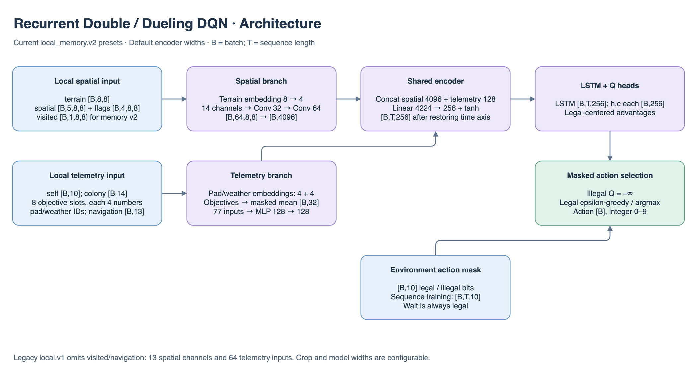
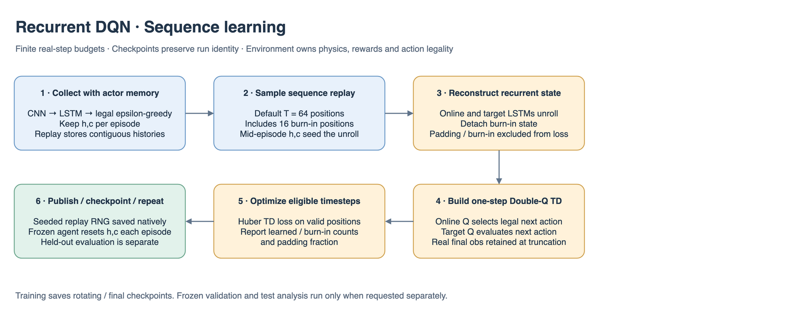

# Recurrent DQN details

## Architecture and learning at a glance

Dimensions in these figures describe the current `local_memory` reference presets at the default 8×8 crop and model widths. `B` is batch size; recurrent models additionally use `T` for sequence length. Smaller smoke models and YAML overrides change these widths; use `resolved_config.yaml` for a particular run. The action space remains `Discrete(10)`.

The shared encoder consumes terrain `[B,8,8]`, five numerical spatial channels `[B,5,8,8]`, four flag channels `[B,4,8,8]`, rover `[B,10]`, colony `[B,14]`, pad/weather IDs, eight objective-type slots, objective values `[B,8,4]` and objective mask `[B,8]`. `local_memory.v2` adds visited `[B,1,8,8]` and navigation `[B,13]`. Terrain embedding contributes four channels; the resulting 14-channel CNN produces 4,096 features. Embedded and pooled telemetry has 77 inputs and produces 128 features. Fusion maps 4,224 → 256. Legacy `local.v1` omits the two memory fields and uses 13 CNN channels / 64 telemetry inputs.

The encoder flattens `[B,T,...]` for CNN processing, then restores `[B,T,256]` for the 256-wide LSTM. External hidden/cell state is `[B,256]` each. Training Q-values are `[B,T,10]`; single-step inference returns `[B,10]`. Default replay length is 64 including 16 burn-in positions, which receive no TD loss.





The PNG figures contain editable draw.io XML: open the PNG directly in draw.io to revise the illustration. Shapes and numbers are grounded in the adjacent model/configuration files and `../common/encoder.py`.

Updated October 16, 2026. Algorithm `recurrent_dqn`, model `local_cnn_lstm_q`, loader `rllib_recurrent_dqn`; install `aresim[rllib]`. Local CPU smoke, seeded checkpoint inference and manual evaluation pass; reference learning remains unverified.

Shared checkpoint transport, sidecar/provenance validation and native module restoration live in `../../training/rllib/checkpoint.py`. Framework-neutral loader dispatch lives in `../../training/checkpoints.py`; resume compatibility lives in `../../training/resume.py`. PPO retains its historical public checkpoint/driver aliases while each algorithm owns its policy-specific inference state.

## Files and flow

- `config.py`: typed Double/Dueling DQN settings plus sequence length, burn-in, and LSTM size.
- `train.py`: recurrent encoder/RLModule, native TD learner diagnostics, seeded resumable episode buffer, and RLlib factory.
- `checkpoint.py`: independent hidden/cell state and seeded epsilon-greedy `Agent`.
- `../../training/rllib/`: shared environment, callbacks, Tune lifecycle, and sidecar export.

Real local observations → shared CNN/telemetry encoder → LSTM → legal-centered value/advantage Q heads → masked greedy/epsilon action. Replay retains contiguous observations, masks, actions, rewards, endings and actor state. The encoder flattens `[B,T,...]` only for CNN processing, then restores `[B,T,F]` for the LSTM. Hidden/cell state is `[B,H]`; Q-values are `[B,T,10]` in training and `[B,10]` in single-step inference.

## Learning and state

V1 uses one-step Double Q targets, uniform episode replay and Huber loss. Default sequences have 64 positions including 16 burn-in positions. Mid-episode replay state seeds the unroll; burn-in state is detached and burn-in/padding has no TD loss. This reduces state staleness, not a claim of complete R2D2 reproduction. Both online and target networks unroll separately; targets select and evaluate legal next actions. Terminal bootstrap is zero; truncated episodes use the last real observation.

All inference/exploration/training paths return state. Epsilon exploration is uniform over legal actions including Q=0. Padding alone may receive a safe Wait mask, and remains excluded from learning. The buffer rejects an entirely ineligible burn-in population, seeds its own RNG and saves that RNG with replay. Ray 2.58's class/string replay constructor mismatch is handled by the small `RecurrentDQN` algorithm subclass.

`train_batch_size` is RLlib's timestep budget, so short tails change sequence count. `learner/recurrent_learned_timesteps`, `learner/recurrent_burn_in_timesteps`, and `learner/recurrent_padding_fraction` expose the actual batch. Checkpoint files use `aresim.checkpoint.rllib.v1` and include native replay. Exact partial-episode RLlib EnvRunner restoration is not claimed.

## Run

```bash
engine/.venv/bin/aresim-rl train configs/recurrent_dqn/smoke.yaml
engine/.venv/bin/aresim-rl evaluate results/recurrent_dqn_smoke_v1/seed_7 --checkpoint final --action-mode both
```

Select **Recurrent DQN** in Algorithm mode with the absolute sidecar path. The frozen agent resets `(h,c)` every episode, updates memory on random as well as greedy actions, and uses `epsilon_end` for stochastic evaluation. See the [implementation guide](../README.md) for matched-memory comparisons, resume compatibility, all presets, and verification evidence.

## Training performance — November 7, 2026

See the [measured pipeline optimizations and GPU benchmark commands](../../../../docs/rl/training_performance.md). Search/learning budgets and model widths are unchanged; CPU component timings do not establish CUDA throughput. Native checkpoint formats are preserved.
